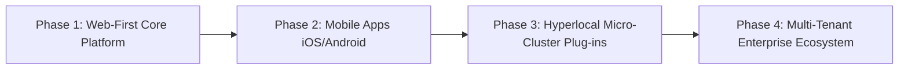
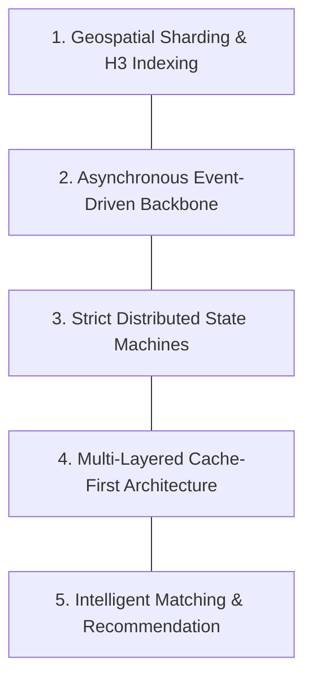

# 01 - Executive Summary: Scalable Food Delivery Platform

## 1. Product Vision & Strategic Positioning

The objective is to architect and build an enterprise-grade, highly scalable food and grocery delivery platform engineered to match the technical sophistication, performance characteristics, and fault tolerance of market leaders such as **Swiggy** and **Zomato**.

While the long-term roadmap accommodates specialized micro-hyperlocal plug-ins (such as university campuses, medical hubs, and gated townships), the immediate engineering mandate is to build an **uncompromising, resilient, web-first core platform** capable of serving standard metropolitan workloads at scale.

---

## 2. The Web-First Advantage

Before committing heavy capital to native iOS and Android application store releases, building a **high-performance web application (PWA / Next.js)** offers strategic benefits:

1. **Instant Onboarding & Zero Install Friction:** Users can browse menus, apply promotions, and place orders via web browsers (Safari, Chrome) without downloading a 70MB app.
2. **Rapid Iteration & Zero App-Store Delay:** Code deployments, A/B tests, and bug fixes occur instantly without waiting for Google Play Store or Apple App Store review cycles.
3. **SEO & Organic Discovery:** Restaurants, dish names, and location pages (`/delhi/connaught-place/biryani`) can be indexed by search engines, generating organic customer acquisition at near-zero CAC.
4. **Desktop & Office Dominance:** Working professionals in tech parks and offices frequently place large team lunch orders directly from desktop browsers.
5. **Shared Backend Core:** All microservices, WebSocket gateways, Kafka pipelines, and database layers built for the web application serve as the direct backend for future native mobile apps with zero rewrite.

---

## 3. Core Architectural Pillars

To sustain millions of daily active users (DAUs) and flash peaks (e.g., Friday evenings, IPL matches, and New Year's Eve surges), the system is built upon five foundational pillars:

### Pillar 1: Geospatial Sharding (Uber H3)
The entire delivery universe is partitioned into hexagonal spatial cells (H3 Resolution 7–9). Searching, restaurant listing, delivery partner pooling, and surge pricing calculations are computed strictly within local hexagonal neighborhoods rather than running expensive global cross-table joins.

### Pillar 2: Asynchronous Event-Driven Backbone (Apache Kafka)
Synchronous HTTP calls between internal services are strictly forbidden for mutable operations. Order creation, rider location pings, restaurant notifications, and inventory updates are published as immutable events to Kafka topics, guaranteeing decoupled scalability and zero cascade failures.

### Pillar 3: Strict Distributed State Machines & Saga Pattern
An order traverses a deterministic state lifecycle (`CREATED -> PAYMENT_CAPTURED -> RESTAURANT_ACCEPTED -> FOOD_PREPARING -> DISPATCHED -> DELIVERED`). Distributed transactions across Payments, Kitchens, and Delivery Fleets are orchestrated via the **Saga Pattern** with automated compensating transactions to eliminate inconsistent dual-writes.

### Pillar 4: Multi-Layered Cache-First Strategy
Every read path (restaurant catalogs, menu item pricing, active rider coordinates) is served out of multi-tiered in-memory caches (Redis / Aerospike) with sub-10ms response latencies, insulating the primary PostgreSQL clusters from read degradation.

### Pillar 5: Intelligent Matching & Recommendation Engines
Real-time dispatch utilizes bipartite matching algorithms (Hungarian / Kuhn-Munkres variants) to optimize rider batching and travel distance. Personalized feeds leverage a two-tower deep retrieval model and real-time feature stores to balance historical user affinities with restaurant operational bandwidth.

---

## 4. Architectural Evolution Roadmap

| Phase | Core Deliverable | Technology Stack Focus | Scale Target |
| :--- | :--- | :--- | :--- |
| **Phase 1 (Current)** | **Production-Ready Web Platform** | Next.js 14, Node.js/Go, PostgreSQL, Redis, Kafka, Razorpay/Stripe | 1,000–5,000 orders/day |
| **Phase 2** | **Mobile Native Apps & Fleet Fleet PWA** | React Native / Flutter, WebSocket Gateway, MQTT location ingestion | 50,000 orders/day |
| **Phase 3** | **Micro-Hyperlocal & Campus Modules** | Gate-to-door dispatchers, batch drop heuristics, student-runner portals | 200,000+ orders/day |
| **Phase 4** | **Hyper-Scale Multi-City Cloud** | Multi-region Kubernetes, Elasticsearch clusters, Aerospike cache, Feast feature store | 1,000,000+ orders/day |

---

## 5. Master Documentation Index

This engineering repository contains 25 exhaustive technical specifications:

* **00-Overview:** Business requirements, SLAs, and domain definitions.
* **01-Swiggy-Zomato-Case-Studies:** Engineering deep dives, flash sale handling, and real-world outage post-mortems.
* **02-System-Architecture-HLD:** Microservices topology, H3 geospatial math, Saga state machine, and real-time tracking pipelines.
* **03-Core-Engines-and-Algorithms:** Dispatch/batching algorithms, recommendation ranking, surge pricing, and search indexing.
* **04-Low-Level-Design-Data-Models:** Complete PostgreSQL relational schema, REST/gRPC API contracts, and Redis data structures.
* **05-Scalability-Infrastructure:** Sharding strategies, Kafka event streaming, observability, circuit breakers, and payment security.
* **06-Web-Platform-Implementation:** Next.js web frontend architecture, backend technology trade-offs, and step-by-step execution plan.
