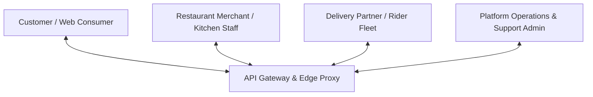
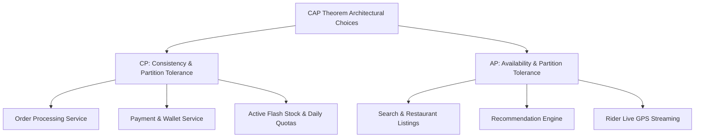

# 02 - Functional & Non-Functional Requirements (FRs & NFRs)

## 1. Domain Actors & Core User Personas

The system coordinates four distinct domain actors interacting simultaneously across distributed state boundaries:

1. **Customer (Web / Mobile Consumer):** Discovers nearby restaurants, browses dynamic menus, customizes dish items, adds to cart, applies promo codes, checks out securely, and monitors live delivery progress on an interactive map.
2. **Merchant (Restaurant Partner):** Receives incoming orders with audible notifications, accepts/rejects orders within a 60-second window, updates preparation status (e.g., *Mark as Food Ready*), modifies real-time item availability (out-of-stock toggling), and manages operating hours.
3. **Delivery Partner (Rider):** Receives algorithmic dispatch requests, views pickup and delivery routes, marks order milestones (*Reached Restaurant*, *Order Picked Up*, *Arrived at Customer Doorstep*, *Delivered*), and continuously streams GPS location pings.
4. **Platform Administrator & Ops Team:** Monitors live supply-demand heatmaps, manages city-level geofencing, overrides automated refunds, monitors partner payouts, and tunes dynamic surge parameters.

---

## 2. Functional Requirements (FRs)

### 2.1 Customer Facing (Web-First)
* **FR-C01 (Geolocated Discovery):** Automatically detect browser geolocation (HTML5 Geolocation API with reverse geocoding fallback) and list open restaurants within the serviceable H3 hexagon cells.
* **FR-C02 (Search & Filtering):** Full-text fuzzy search across restaurants, cuisines, and dish names. Real-time filtering by rating, delivery time, veg/non-veg, price tier, and ongoing discount offers.
* **FR-C03 (Interactive Cart & Customization):** Support nested add-ons, portion sizes (e.g., Half/Full), cooking notes, and multi-restaurant prevention with clear UI warnings.
* **FR-C04 (Checkout & Payment Orchestration):** Seamless integration with UPI, Credit/Debit cards, Net Banking, and Wallets. Support idempotency tokens to prevent accidental double-charges.
* **FR-C05 (Real-Time Order Tracking):** Live WebSocket connection rendering delivery partner movement, accurate dynamic ETA, and step-by-step milestone tracking.
* **FR-C06 (Post-Order Feedback):** Multi-dimensional ratings (Food Quality rating for restaurant, Delivery Speed/Behavior rating for delivery partner).

### 2.2 Merchant Facing (Web & Merchant Portal)
* **FR-M01 (Order Acceptance Console):** Real-time order dispatch modal with an audible alarm and auto-rejection timeout (default: 90 seconds).
* **FR-M02 (Dynamic Catalog Management):** Instant toggle of dish availability (`is_available = false`) with instant cache invalidation across customer search indexes within < 1 second.
* **FR-M03 (Kitchen Preparation Signaling):** One-click button signaling "Food Ready", which dynamically triggers immediate delivery partner dispatch to the kitchen counter.

### 2.3 Delivery Fleet Facing
* **FR-D01 (Dispatch Acceptance):** Delivery partner receives a batch or single pickup notification with estimated trip earnings, pickup distance, and drop-off coordinates. 15-second acceptance countdown.
* **FR-D02 (Continuous Telemetry Streaming):** Pushes device GPS latitude, longitude, heading, and speed every 3–5 seconds over a low-bandwidth WebSocket/MQTT connection.
* **FR-D03 (Proof of Delivery):** Secure OTP verification or QR code scan prior to completing high-value deliveries.

---

## 3. Non-Functional Requirements (NFRs)

### 3.1 Availability & Fault Tolerance
* **System Uptime Target:** **99.99% Availability** (~52.6 minutes of unplanned downtime per year).
* **Zero Single Point of Failure (SPOF):** Every microservice must be deployed across at least 3 availability zones (AZs) behind redundant load balancers.
* **Graceful Degradation:** If the Recommendation Engine fails, fallback instantly to a static "Top Rated Nearby" cached list. If the Dynamic Pricing Service fails, fallback to zero surge. The order checkout path must **never** be blocked by secondary analytical services.

### 3.2 Latency SLAs & Benchmarks
All latencies measured at the 99th percentile (p99) under peak load:

| Operation | Latency SLA (p95) | Latency SLA (p99) | Notes |
| :--- | :--- | :--- | :--- |
| **Home Screen Restaurant Feed** | < 150 ms | < 300 ms | Heavy multi-tier Redis caching + H3 lookup |
| **Catalog / Menu View** | < 80 ms | < 150 ms | Static cache hit ratio must exceed 96% |
| **Full-Text Dish Search** | < 120 ms | < 250 ms | Elasticsearch/OpenSearch with pre-warmed queries |
| **Order Placement / Checkout Initiation** | < 300 ms | < 600 ms | Distributed locks + Saga coordinator bootstrap |
| **Rider GPS Telemetry Ingestion** | < 30 ms | < 70 ms | Asynchronous Kafka ingest via Go/Netty proxy |
| **Live Tracking Map Refresh** | < 500 ms | < 1,000 ms | Server-Sent Events (SSE) or WebSocket push |

### 3.3 Consistency vs. Availability (CAP Theorem Decisions)

* **Financial & Order Processing (CP):** Uses strict serializable or snapshot isolation in PostgreSQL. Double spending, phantom orders, and oversold inventory are strictly impossible.
* **Discovery, Search & Tracking (AP):** Uses eventual consistency. If a restaurant updates its description or a rider’s location lag is 2 seconds, availability and sub-100ms response times take priority.

---

## 4. Peak Capacity Estimation & Math

### Baseline Scale Model (100,000 Daily Orders)
* **Daily Total Orders:** $100,000$ orders / day.
* **Peak Window:** 60% of all orders arrive during two 2-hour peak windows (Lunch: 12:30 PM – 2:30 PM, Dinner: 7:30 PM – 9:30 PM = 4 hours total).
* **Peak Window Volume:** $60,000$ orders across 4 hours $= 15,000$ orders / hour.
* **Peak Orders Per Second (OPS):**
  $$\text{Peak OPS} = \frac{15,000}{3,600 \text{ seconds}} \approx 4.16 \text{ orders/second}$$
* **Flash Surge Multiplier (IPL Final / New Year's Eve):** $10 \times \text{ Surge} \implies \mathbf{42 \text{ orders/sec}}$.

### Browsing & Search Read Amplification (1:50 Ratio)
For every completed order, an average user performs 50 search queries, menu opens, item additions, and feed scrolls:
* **Peak Search & Feed QPS:** $42 \text{ OPS} \times 50 \text{ actions} \approx \mathbf{2,100 \text{ QPS}}$ sustained, peaking at **$5,000 \text{ QPS}$**.

### Delivery Telemetry Ingestion Scale
* **Active Delivery Partners Online:** $5,000$ riders.
* **Ping Frequency:** 1 ping every 4 seconds.
* **GPS Ingestion Throughput:**
  $$\text{GPS Ingestion Rate} = \frac{5,000 \text{ riders}}{4 \text{ seconds}} = \mathbf{1,250 \text{ pings/second}}$$
* **Payload Size:** ~200 bytes per ping (RiderID, Timestamp, Lat, Lng, Accuracy, Speed).
* **Telemetry Network Bandwidth:** $1,250 \times 200 \text{ bytes} \approx 250 \text{ KB/sec}$ (negligible network footprint when using binary Protobuf/gRPC over raw HTTP JSON).
