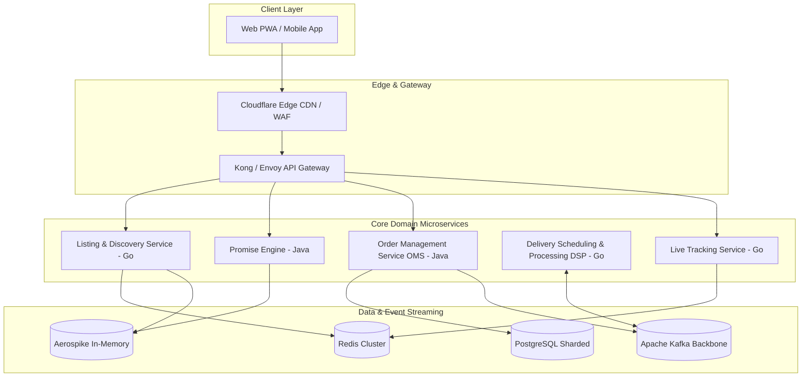
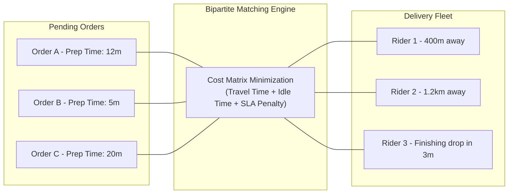

# 03 - Swiggy Engineering Deep Dive: Architecture at Extreme Scale

## 1. Architectural Evolution: Monolith to Hyper-Scale Microservices

Swiggy began in 2014 as a monolithic Ruby on Rails application backed by a single MySQL database. By 2017–2018, as transaction volumes grew by 100x, this architecture experienced catastrophic database connection pool exhaustion and deploy-time locks.

Swiggy undertook a systematic re-architecture into a polyglot microservices model, standardizing primarily on **Go** (for high-throughput, low-latency microservices like telemetry and routing) and **Java / Spring Boot** (for business-critical transactional domains like orders and payments).

---

## 2. Core Secret: The Swiggy "Promise Engine"

Before a user clicks "Order Now", Swiggy displays an accurate ETA: *"Delivery in 28 mins"*. If the ETA is too high, conversion drops; if the ETA is understated, customer dissatisfaction and support tickets skyrocket.

The **Promise Engine** computes this dynamic SLA in real-time across four distinct variables:

$$\text{Total ETA} = \text{FPT} + \text{FM\_Travel} + \text{LM\_Travel} + \text{Buffer}$$

1. **First-Mile Travel Time ($\text{FM\_Travel}$):** Time required for the optimal Delivery Executive (DE) to drive from their current location to the restaurant.
2. **Food Preparation Time ($\text{FPT}$):** Dynamically predicted prep time using machine learning models factoring in:
   * Current kitchen load (active pending orders at that specific restaurant).
   * Specific dish complexity (Biryani is pre-cooked vs. Tandoori Roti made on order).
   * Historical prep time trends for the current hour and day of the week.
3. **Last-Mile Travel Time ($\text{LM\_Travel}$):** Real-time routing from the restaurant to the customer doorstep, considering historical traffic speeds, rain conditions, and terrain.
4. **Buffer:** Safety buffer computed based on delivery partner supply deficit in that specific H3 hexagon.

---

## 3. The Delivery Scheduling & Processing (DSP) Engine

Swiggy assigns hundreds of thousands of delivery executives using an algorithmic dispatch engine known as **DSP**. Instead of greedily assigning the closest delivery partner to an order, DSP solves a **Global Bipartite Matching Problem**:

### Why Greedy Assignment Fails
If Rider 1 is 300 meters from Restaurant A, but Restaurant A needs 25 minutes to cook the food, assigning Rider 1 immediately forces the rider to stand outside the kitchen for 20 minutes doing nothing ("Rider Idle Time"). 

### Swiggy's "Just-in-Time" Dispatch
DSP calculates the exact moment when the rider should begin driving so they arrive at the kitchen counter **at the exact minute the food is packed**. If prep time is 18 minutes and travel time is 6 minutes, the dispatch request is withheld for 12 minutes before pinging the rider.

---

## 4. How Swiggy Handles Flash Events (New Year's Eve & IPL)

During New Year's Eve (NYE) and major IPL cricket finals, Swiggy regularly processes **over 9,000 to 12,000 orders per minute**.

### Key Strategies Employed:
1. **Aggressive Circuit Breaking & Graceful Degradation:**
   * If downstream recommendation services experience elevated p99 latency (> 500ms), circuit breakers instantly trip and serve static cached category feeds.
   * Personalization algorithms are turned off in favor of simple popularity-based lists, freeing up 40% of compute capacity.
2. **Pre-Warming & Elastic Scaling:**
   * Kubernetes pod counts (HPA) are scaled up 4x hours before the 7:00 PM dinner peak.
   * Redis and Aerospike caches are pre-warmed with all active menus, prices, and merchant statuses.
3. **Load Shedding at the Edge:**
   * Kong and Envoy edge proxies employ token-bucket rate limiting. If downstream services hit 85% CPU saturation, non-critical background pings (like browsing telemetry) are dropped at the edge to guarantee 100% capacity for the checkout and payment funnel.
4. **Decoupled Asynchronous Order Ingestion:**
   * Once payment succeeds, the order payload is pushed directly into an Apache Kafka topic. The client receives an immediate `202 Accepted` response. Background worker pools consume from Kafka to update merchant dashboards and initialize dispatch state machines.

---

## 5. Architectural Lessons for Our Platform

| Swiggy Architectural Pattern | How We Will Implement It |
| :--- | :--- |
| **Separation of Read & Write Paths** | CQRS (Command Query Responsibility Segregation). Redis/Elasticsearch for listing; PostgreSQL for order mutation. |
| **Just-in-Time Dispatch** | Delay rider allocation based on predicted prep time to eliminate rider idle time. |
| **Decoupled Order Placement** | Payment confirmation pushes order event to Kafka/RabbitMQ; clients poll or listen on WebSockets for async completion. |
| **Edge Cache Pre-warming** | Store restaurant menus as immutable JSON snapshots in Redis, invalidated only on explicit merchant edits. |
