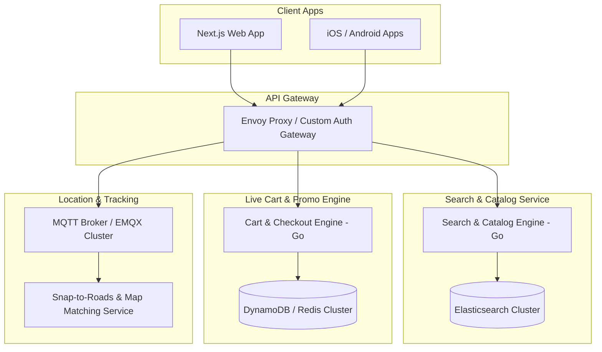
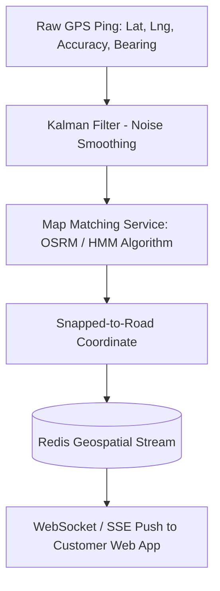
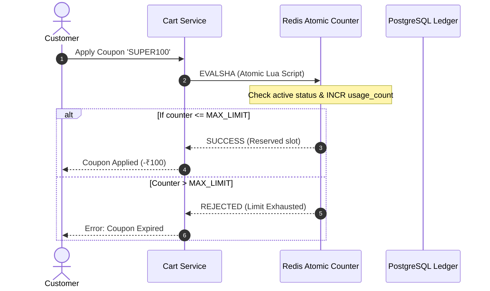

# 04 - Zomato Engineering Deep Dive: Search, Tracking & Live Scale

## 1. Architectural Evolution & Modern Tech Stack

Zomato originated in 2008 as a restaurant discovery and review portal built on a LAMP stack (Linux, Apache, MySQL, PHP). When transitioning to full-scale food ordering and delivery, the monolithic PHP code was dismantled in favor of high-performance microservices:

* **Microservices Framework:** Go (Golang) and Java for latency-sensitive core systems (Search, Order Processing, Telemetry).
* **Caching & High-Velocity Storage:** Aerospike, Redis, and AWS DynamoDB.
* **Persistent Relational Tier:** Highly optimized PostgreSQL and MySQL clusters partitioned by geographical cluster ID.
* **Search & Discovery Engine:** Multi-node Elasticsearch (OpenSearch) cluster with custom analyzers for Indian cuisine phonetics and typos.

---

## 2. The Search & Discovery Engine Architecture

Searching for food in India presents unique linguistic challenges:
* Users search phonetically (*"biryani"*, *"biryani"*, *"briyani"*).
* Cuisines and dishes cross languages (*"dal makhani"*, *"paneer butter masala"*).
* Queries combine dish names, restaurant names, and dietary restrictions (*"veg thali near me"*).

### Zomato's Search Pipeline:

1. **Custom N-Gram & Levenshtein Distance Analyzers:** Configured with an edit distance of 1–2 for sub-string matching, allowing instant corrections for misspelled dish titles.
2. **Intent Classification:** Determines if a query is a **Dish** (e.g., "Butter Chicken"), a **Brand** (e.g., "McDonald's"), or a **Dietary Filter** (e.g., "Pure Veg").
3. **Spatial Geofilter:** Filters candidates strictly within the active delivery radius (H3 hexagon index) before executing text relevance scoring, reducing the search space by 98%.
4. **Learning-to-Rank (LTR):** Re-ranks search results based on real-time factors:
   * Distance between user and kitchen.
   * Historical order frequency from this restaurant.
   * Merchant rating and operational kitchen strain.

---

## 3. Real-Time Telemetry & Live Tracking Pipeline

Transmitting live GPS pings from tens of thousands of delivery partners to end-users without draining rider phone batteries or crashing backend servers requires specialized communication protocols:

### Protocol Choice: MQTT vs. WebSockets vs. HTTP Polling
* **HTTP Polling:** Rejected due to excessive TCP handshake overhead, header bloat, and server strain.
* **WebSockets:** Used for browser-based web clients connecting to the platform.
* **MQTT (Message Queuing Telemetry Transport):** Used for delivery partner mobile devices. MQTT offers a tiny 2-byte header, operates reliably over unstable 3G/4G network handovers, and supports QoS (Quality of Service) levels.

### The "Snap-to-Road" & Dead Reckoning Pipeline
Raw GPS data from budget smartphones is notoriously noisy: riders appear to jump through buildings or drift into rivers.

1. **Kalman Filtering:** Smooths out raw GPS jitter and filters out readings where horizontal accuracy exceeds 30 meters.
2. **Hidden Markov Model (HMM) Map Matching:** Snaps coordinates to actual OpenStreetMap (OSM) road vectors.
3. **Dead Reckoning & Client-Side Interpolation:** Instead of sending 1 ping per second, the device sends 1 ping every 4–5 seconds. The customer web client uses smooth mathematical bezier-curve interpolation to animate the delivery scooter across the map continuously.

---

## 4. The Promotion & Coupon Engine: Zero Race Conditions

During flash promotions (e.g., "First 1,000 orders get ₹100 off"), thousands of concurrent requests attempt to apply the same coupon code simultaneously.

### The Concurrency Problem:
If two requests read `coupon.usage_count = 999` at the same microsecond, both will validate and claim the code, resulting in overselling.

### Zomato's Atomic Validation Pattern:

By executing the quota check and increment inside a **Redis Lua script**, the operation executes atomically on a single Redis thread, guaranteeing zero race conditions at 50,000+ requests per second.

---

## 5. Architectural Lessons for Our Platform

| Zomato Architecture Pattern | Application to Our System |
| :--- | :--- |
| **Phonetic & Fuzzy Search** | Implement OpenSearch with custom N-gram analyzers for regional and colloquial food queries. |
| **MQTT / WebSocket Telemetry** | Ingest rider coordinates via lightweight streaming protocols; smooth tracks using client-side bezier interpolation. |
| **Atomic Lua Scripting** | Protect coupon redemptions, inventory locks, and daily cart limits in Redis using atomic Lua transactions. |
| **Map Matching** | Utilize Open Source Routing Machine (OSRM) to snap coordinates to roads before calculating live ETAs. |
