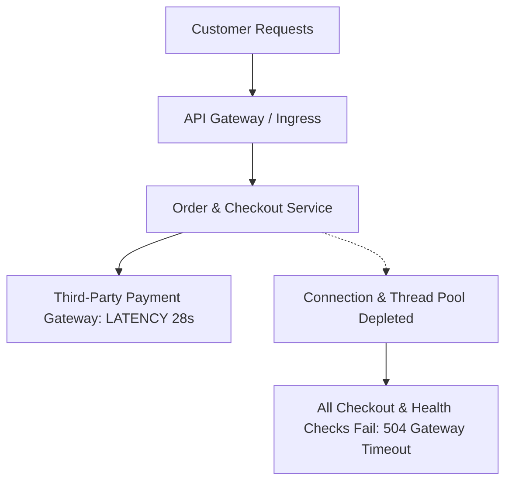
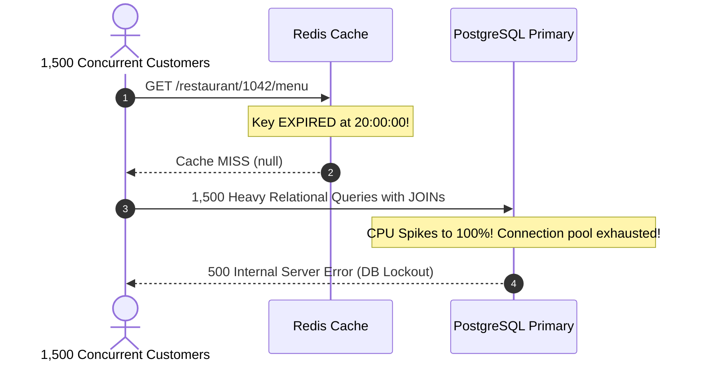
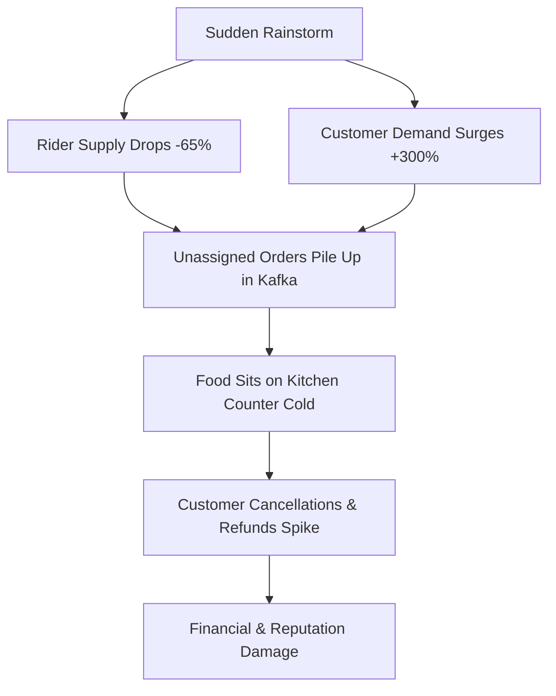

# 05 - Real-World Outages, Cascading Failures & Post-Mortems

## 1. Case Study 1: The Payment Gateway Timeout Cascade (Thread Starvation)

### Incident Breakdown:
During a high-traffic cricket tournament, a primary third-party payment aggregator experienced a 90% latency spike, increasing transaction response times from 800ms to 28 seconds before failing.



### Root Cause:
The Order Service utilized synchronous, blocking HTTP worker threads. As requests waited 28 seconds for the payment gateway response, the service's maximum thread pool (500 threads) was exhausted in less than 3 seconds. New incoming requests—even for unrelated non-payment endpoints—queued up, causing the API gateway to return `504 Gateway Timeout` across the entire platform.

### Architectural Fix Implemented:
1. **Aggressive Client-Side Timeouts:** Hard timeout of 3.5 seconds on all external HTTP requests.
2. **Bulkhead Pattern:** Isolate thread pools for third-party external integrations from internal microservices. If payments stall, discovery and cart services remain responsive.
3. **Circuit Breaker (Envoy / Resilience4j):** If payment failure rates exceed 30% over a 10-second rolling window, open the circuit immediately and fall back to alternative payment gateways (e.g., dynamically route from Razorpay to Stripe or Cashfree) without waiting for timeouts.

---

## 2. Case Study 2: The Cache Stampede (Dogpiling) on Popular Outlets

### Incident Breakdown:
At 8:00 PM on Friday, the most popular burger joint in a major city had its menu cache expire simultaneously across all application servers.



### Root Cause:
The cache key `restaurant:1042:menu` had a static TTL of 3,600 seconds. The moment it expired, 1,500 concurrent users hitting the page generated 1,500 simultaneous complex SQL queries joining `restaurants`, `categories`, `menu_items`, and `modifiers`. The PostgreSQL primary database crashed under connection pool saturation.

### Architectural Fix Implemented:
1. **Probabilistic Early Expiration (XFetch Algorithm):**
   Compute dynamic early refresh before the key actually expires:
   $$\text{Refresh Condition: } -\beta \times \delta \times \ln(\text{random}()) > \text{remaining\_ttl}$$
2. **Distributed Mutex (Singleflight / Redis Redlock):**
   Only the first worker to observe a cache miss acquires an in-memory lock to query PostgreSQL. The other 1,499 requests block and wait for the single worker to populate Redis, then read directly from cache.
3. **Jittered TTLs:** Append randomized jitter to all cache TTLs:
   $$\text{TTL} = \text{Base\_TTL} + \text{rand}(0, 300 \text{ seconds})$$

---

## 3. Case Study 3: The Hyperlocal Supply-Demand Death Spiral

### Incident Breakdown:
A sudden torrential rainstorm hit a dense delivery cluster. Within 10 minutes, available delivery partner supply dropped by 65% (riders taking shelter), while customer order demand surged by 300%.



### Root Cause:
The platform continued accepting orders at standard delivery promises without throttling. Kitchens cooked food, but with zero riders available, food sat on counters for 60+ minutes. Customers canceled orders after preparation, forcing the platform to absorb 100% of the food wastage cost and refund the customer.

### Architectural Fix Implemented:
1. **Automated Dynamic Geofencing & Circuit Breakers:**
   When the unassigned order queue in an H3 cell exceeds a critical threshold ($\text{Ratio} > 2.5 \text{ orders per active rider}$), the system automatically:
   * Expands ETA promises from 30 mins to 75 mins on the frontend.
   * Decreases the restaurant discovery radius from 7 km to 2.5 km.
   * Initiates dynamic surge pricing to cool demand and incentivize riders.
   * If supply drops below minimum viable safety thresholds, gracefully puts the affected H3 hexagon into *"Temporary Rain Pause"*, disabling new cart checkouts until equilibrium is restored.

---

## 4. Resilience Architecture Rules for Our Platform

```
+-------------------------------------------------------------------------------+
|                      CORE SYSTEM RESILIENCE PRINCIPLES                        |
+-------------------------------------------------------------------------------+
| 1. NEVER execute un-bounded HTTP calls (Max timeout: 3,000ms).               |
| 2. NEVER allow synchronous external dependencies in the checkout critical path.|
| 3. ALWAYS employ Singleflight / Redis Mutex on cache misses.                  |
| 4. ALWAYS append random jitter to cache expirations.                          |
| 5. ALWAYS employ automated supply-demand circuit breakers on delivery clusters.|
+-------------------------------------------------------------------------------+
```
