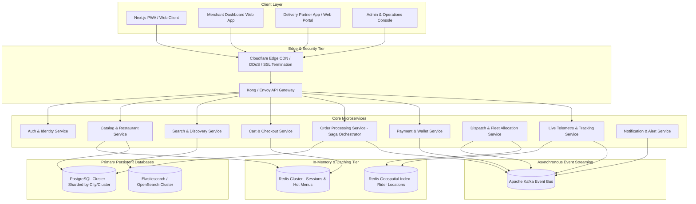
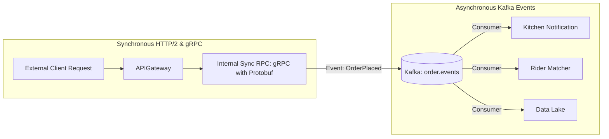

# 06 - High-Level System Architecture (HLD)

## 1. System Topology & The C4 Container Model

The architecture follows a distributed, event-driven microservices pattern engineered around decoupled bounded contexts:

---

## 2. Microservice Bounded Contexts & Responsibilities

| Microservice | Primary Language / Runtime | Primary Database | Key Responsibilities |
| :--- | :--- | :--- | :--- |
| **Auth & Identity** | Node.js / Go | PostgreSQL + Redis | JWT token issuance, session refresh, role-based access control (RBAC), OTP validation. |
| **Catalog & Restaurant** | Go / Node.js | PostgreSQL + Redis | Restaurant profiles, operational hours, menus, categories, dish modifiers, and live availability toggling. |
| **Search & Discovery** | Go | Elasticsearch / OpenSearch | Fuzzy dish search, cuisine filtering, geospatial radius queries, ranking algorithm execution. |
| **Cart & Pricing** | Go / Node.js | Redis Cluster | Live cart calculation, item customization validation, dynamic delivery fee and tax computation. |
| **Order Processing (OMS)** | Java / Spring Boot or Go | PostgreSQL (ACID) | Order lifecycle state machine, Saga transaction orchestration, order cancellation workflows. |
| **Payment & Billing** | Go / Java | PostgreSQL (Strict ACID) | Payment gateway integration (Razorpay, Stripe), webhook verification, refunds, merchant settlement ledger. |
| **Dispatch & Fleet** | Go / Python (ML) | Redis Geo + PostgreSQL | Real-time bipartite matching, rider assignment, batching optimization, and route planning. |
| **Live Telemetry & Tracking**| Go (Goroutines) | Redis Streams + EMQX | Ingestion of high-frequency GPS pings, map matching, WebSocket/SSE broadcasting to clients. |
| **Notification Service** | Node.js / Go | RabbitMQ / Kafka | Multi-channel fanout: Web push notifications, SMS alerts, WhatsApp updates, and email receipts. |

---

## 3. Communication Protocols: Sync vs. Async Matrix

To prevent cascading failures and guarantee responsive UI experiences, communication protocols are strictly governed:

1. **Client-to-Gateway:** HTTPS/2 with TLS 1.3 for secure, multiplexed web requests.
2. **Gateway-to-Internal Services:** High-performance **gRPC with binary Protobuf** serialization for internal service-to-service RPC, delivering up to 7x higher throughput compared to raw JSON over HTTP/1.1.
3. **Event-Driven Inter-Service Workflows:** **Apache Kafka** is used for all state transitions, order lifecycle notifications, and data replication. Producers write asynchronously without waiting for downstream consumer completion.

---

## 4. Edge Layer & Security Architecture

1. **Cloudflare Edge CDN:**
   * Caches static web assets (JavaScript chunks, CSS, images, WebP food thumbnails).
   * Web Application Firewall (WAF) blocks automated scrapers, SQL injection, and DDoS volumetric attacks.
   * SSL/TLS termination at the nearest edge point-of-presence (PoP).
2. **API Gateway (Kong / Envoy):**
   * **Authentication Verification:** Validates HMAC-signed JWTs at the perimeter; unauthorized requests are rejected before reaching internal microservices.
   * **Token-Bucket Rate Limiting:** Enforces per-IP and per-User rate limits (e.g., maximum 100 requests/minute for general endpoints, 5 requests/minute for checkout and OTP generation).
   * **Request Routing & Path Rewriting:** Seamlessly routes `/api/v1/search/*` to the Search cluster and `/api/v1/orders/*` to the Order Processing cluster.
