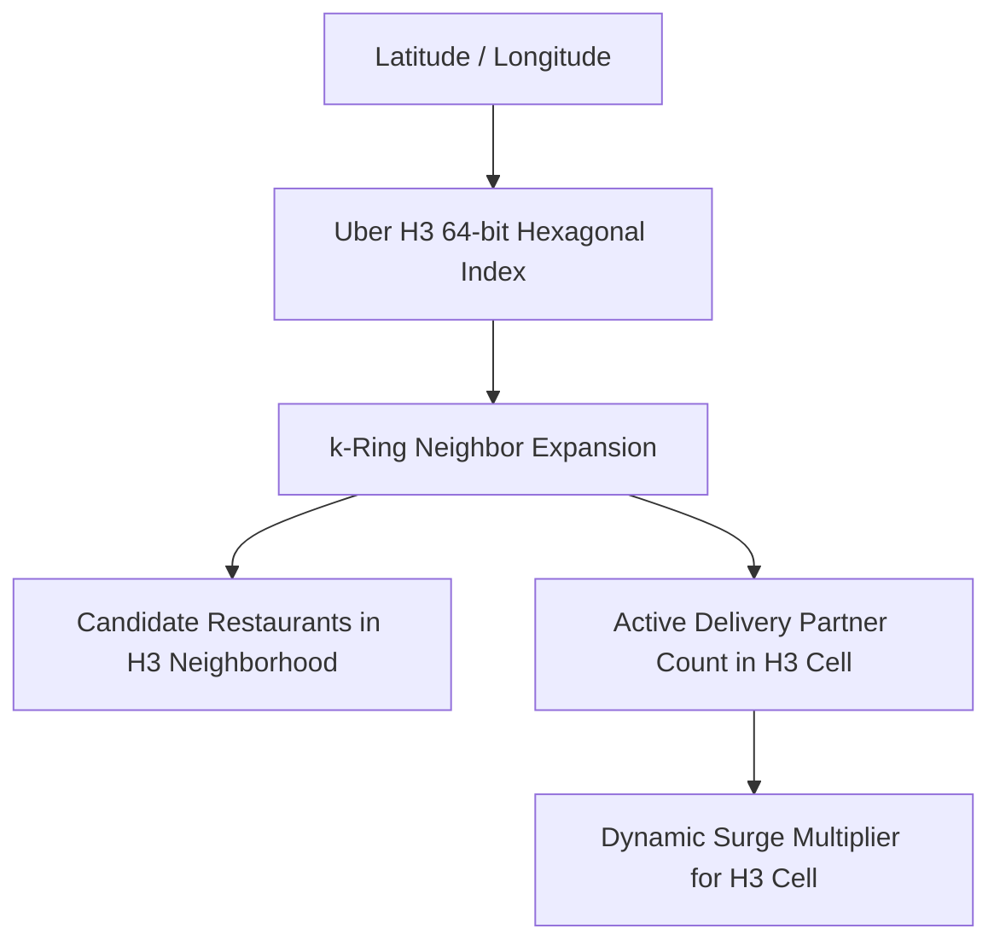
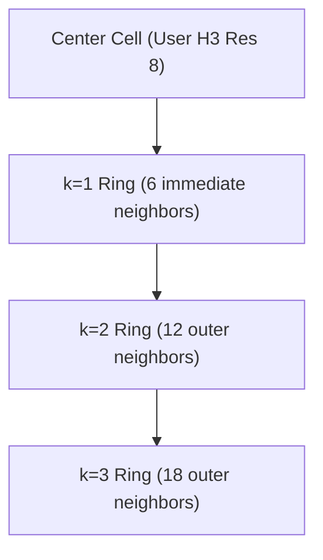

# 07 - Geospatial Indexing & Uber H3 Hexagonal Grid Architecture

## 1. Why Uber H3 Hexagons Over Geohashes and Squares?

Traditional spatial databases partition geographic space using rectangular grids or standard Geohashes (base-32 encoding of quadtrees). However, rectangular grids introduce geometric distortions:

```
Square Grid (8 Neighbors):
- Orthogonal neighbors: Distance = D
- Diagonal neighbors:   Distance = D * sqrt(2) = 1.414 * D
[DIAGONAL DISTORTION]

Hexagonal Grid (H3 - 6 Neighbors):
- ALL 6 adjacent neighbors have identical Euclidean distance from the center point!
[UNIFORM NEIGHBOR DISTANCE]
```



### Advantages for Food Delivery:
1. **Invariant Neighbor Distances:** In an H3 hexagonal cell, moving to any of the 6 neighboring cells covers the exact same distance. This simplifies spatial smoothing and gradient algorithms.
2. **Reduced Quantization Error:** Hexagons minimize the perimeter-to-area ratio, reducing boundary edge cases where a user and a restaurant are 50 meters apart but placed in separate square cells.
3. **Hierarchical Multi-Resolution Nesting:** H3 supports 16 resolutions. Finer hexagons nest cleanly into coarser parent hexagons, allowing effortless multi-tier aggregations.

---

## 2. H3 Resolution Strategy for Food Delivery

| H3 Resolution | Avg Hexagon Area | Avg Edge Length | System Usage in Our Architecture |
| :---: | :---: | :---: | :--- |
| **Resolution 6** | $36.1 \text{ km}^2$ | $3.2 \text{ km}$ | City-level high-level demand heatmaps, warehouse distribution. |
| **Resolution 7** | $5.16 \text{ km}^2$ | $1.22 \text{ km}$ | **Dynamic Surge Pricing & Macro-Geofencing** (Determining rain surge). |
| **Resolution 8** | $0.737 \text{ km}^2$ | $461 \text{ meters}$ | **Restaurant Discovery Feed** ($k$-ring 4 to 6 gives ~3–5 km radius). |
| **Resolution 9** | $0.105 \text{ km}^2$ | $174 \text{ meters}$ | **Fleet Dispatch & Campus Clusters** (Rider pooling & batching). |

---

## 3. k-Ring Spatial Expansion Algorithm

When a user opens the web application at location $(\text{lat}, \text{lng})$:
1. Convert user coordinate to an **H3 Resolution 8 index**.
2. Perform a **$k$-ring expansion** ($k=5$, covering approximately a 4.5 km service radius).
3. The result is a set of ~61 contiguous hexagonal cell IDs.
4. Execute an indexed lookup in Redis or PostgreSQL:
   ```sql
   SELECT restaurant_id FROM restaurant_service_zones 
   WHERE h3_index = ANY(ARRAY['88618925d3fffff', '88618925d1fffff', ...]);
   ```
5. This replaces expensive trigonometric spatial math (`ST_DWithin` on millions of rows) with high-speed integer/string array hash lookups taking **less than 2 milliseconds**.



---

## 4. Production Code Implementation: H3 Geospatial Utilities

Below is a production-ready TypeScript utility utilizing the official `h3-js` library:

```typescript
import { 
  latLngToCell, 
  gridDisk, 
  cellToLatLng, 
  gridDistance, 
  getResolution 
} from "h3-js";

export class GeoSpatialService {
  // Resolution 8: Standard delivery discovery zone (~460m edge)
  private static readonly DISCOVERY_RESOLUTION = 8;
  
  // Resolution 9: Micro-cluster / Rider pooling zone (~174m edge)
  private static readonly DISPATCH_RESOLUTION = 9;

  /**
   * Convert GPS coordinates to H3 Cell Index
   */
  public static getH3Index(lat: number, lng: number, resolution = this.DISCOVERY_RESOLUTION): string {
    return latLngToCell(lat, lng, resolution);
  }

  /**
   * Retrieve all neighbor cell IDs within k-rings (Serviceable Radius)
   * k = 5 covers approx. 4.5 km radius around user
   */
  public static getServiceableHexagons(lat: number, lng: number, kRingRadius = 5): string[] {
    const centerCell = latLngToCell(lat, lng, this.DISCOVERY_RESOLUTION);
    // gridDisk returns the origin cell and all cells within k steps
    return gridDisk(centerCell, kRingRadius);
  }

  /**
   * Compute hexagonal grid distance between two H3 indices
   */
  public static computeCellDistance(originH3: string, destinationH3: string): number {
    return gridDistance(originH3, destinationH3);
  }

  /**
   * Calculate supply-demand deficit ratio for surge pricing
   */
  public static calculateHexagonSurgeFactor(
    activeOrdersInCell: number, 
    availableRidersInCell: number
  ): number {
    if (availableRidersInCell === 0 && activeOrdersInCell > 0) {
      return 2.0; // Maximum surge multiplier
    }
    const ratio = activeOrdersInCell / Math.max(availableRidersInCell, 1);
    if (ratio > 3.0) return 1.8;
    if (ratio > 2.0) return 1.5;
    if (ratio > 1.2) return 1.2;
    return 1.0; // Normal pricing
  }
}
```

---

## 5. Storage Architecture in Redis & PostgreSQL

### Redis Geospatial Caching Structure:
* **Key:** `h3:riders:res9:<h3_index>` (Redis Set containing active `rider_id` strings).
* **TTL:** Expired automatically if no GPS ping received in 45 seconds.
* When dispatching, the engine simply checks the set cardinality:
  ```bash
  SCARD h3:riders:res9:89618925d3fffff
  ```

### PostgreSQL Table Indexing:
```sql
CREATE TABLE restaurant_coverage_zones (
    restaurant_id UUID NOT NULL REFERENCES restaurants(id) ON DELETE CASCADE,
    h3_index VARCHAR(15) NOT NULL,
    PRIMARY KEY (restaurant_id, h3_index)
);

-- B-Tree index on h3_index for lightning-fast k-ring lookups
CREATE INDEX idx_coverage_h3 ON restaurant_coverage_zones(h3_index);
```
