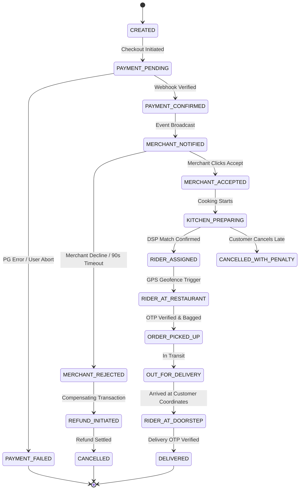

# 08 - Order Lifecycle Distributed State Machine

## 1. Complete Order State Machine & Lifecycle

An order in a food delivery platform is a mission-critical distributed finite state machine (FSM). Invalid state jumps (e.g., an order jumping from `CREATED` directly to `DELIVERED`, or transitioning to `REFUNDED` after delivery without admin approval) can cause major financial leakage.



---

## 2. Formal State Transition Matrix

| From State | Allowed Target State | Triggering Event / Actor | Timeout SLA | Compensating / Side Effect |
| :--- | :--- | :--- | :--- | :--- |
| `CREATED` | `PAYMENT_PENDING` | User clicks "Proceed to Pay" | 15 mins | Reserve cart items & active coupons |
| `PAYMENT_PENDING` | `PAYMENT_CONFIRMED` | Razorpay/Stripe Webhook Verified | 5 mins | Emit `OrderPaidEvent` to Kafka |
| `PAYMENT_PENDING` | `PAYMENT_FAILED` | Gateway returns failure | - | Release reserved cart items & coupons |
| `PAYMENT_CONFIRMED` | `MERCHANT_NOTIFIED` | OMS pushes to Merchant Console | 5 secs | Trigger sound alarm on Merchant Web |
| `MERCHANT_NOTIFIED` | `MERCHANT_ACCEPTED` | Merchant clicks "Accept" | **90 secs** | Update estimated prep time in DB |
| `MERCHANT_NOTIFIED` | `MERCHANT_REJECTED` | Merchant rejects or timeout fires | **90 secs** | Trigger automated full refund via PG |
| `MERCHANT_ACCEPTED` | `KITCHEN_PREPARING` | Timer begins / Kitchen signals | - | Display "Food being cooked" to user |
| `KITCHEN_PREPARING` | `RIDER_ASSIGNED` | DSP algorithm matches rider | 5 mins | Notify rider with 15s acceptance window |
| `RIDER_ASSIGNED` | `RIDER_AT_RESTAURANT` | Rider enters 50m geofence | - | Push status update to merchant |
| `RIDER_AT_RESTAURANT` | `ORDER_PICKED_UP` | Rider verifies 4-digit pickup code | - | Rider begins transit to customer |
| `ORDER_PICKED_UP` | `OUT_FOR_DELIVERY` | Rider taps "Start Delivery" | - | Enable live WebSocket GPS tracking |
| `OUT_FOR_DELIVERY` | `RIDER_AT_DOORSTEP` | Rider enters 50m customer geofence | - | Send SMS/Push: "Rider at your gate" |
| `RIDER_AT_DOORSTEP` | `DELIVERED` | Customer delivery OTP verified | - | Release rider to pool; credit payout |

---

## 3. Strict State Enforcement & Idempotency in Code

State transitions are protected using optimistic concurrency control with PostgreSQL version numbers (`row_version`):

```sql
-- Atomic state transition with version lock
UPDATE orders 
SET 
    status = 'MERCHANT_ACCEPTED',
    updated_at = NOW(),
    row_version = row_version + 1
WHERE 
    id = 'd3b07384-d113-4a44-a035-7c08b292e74e' 
    AND status = 'MERCHANT_NOTIFIED'
    AND row_version = 3;
```
If the query returns `0 rows affected`, another process already modified the state (e.g., auto-rejection timer fired while merchant clicked accept), preventing conflicting updates.

---

## 4. Edge Cases & Exception Handling

### Edge Case 1: Merchant Auto-Rejection Timeout (90 Seconds)
* If the merchant does not respond within 90 seconds, a distributed Redis delayed queue fires a timer event.
* The order status is transitioned to `MERCHANT_REJECTED_TIMEOUT`.
* The Saga orchestrator immediately triggers a full refund API call to the payment gateway.
* The customer receives a push alert: *"Restaurant could not accept your order. ₹450 has been refunded to your source account."*

### Edge Case 2: Customer Cancels After Kitchen Begins Cooking
* **Before Merchant Acceptance:** 100% refund, immediate cancellation.
* **During `KITCHEN_PREPARING`:** The customer is informed: *"Food preparation has begun. Cancelling will incur a 100% cancellation charge to compensate the restaurant."* If confirmed, the restaurant is paid their item fee, the platform retains its fee, and zero refund is issued.

### Edge Case 3: Delivery Partner Cannot Find Customer
* Rider must wait at the geofence location for a mandatory **8-minute countdown timer**.
* System initiates 2 automated telephone call bridges between rider and customer.
* If unanswered after 8 minutes, rider marks `DELIVERY_UNSUCCESSFUL_CUSTOMER_UNREACHABLE`. The order is terminated, items returned or discarded according to merchant policy, and the customer is charged in full.
