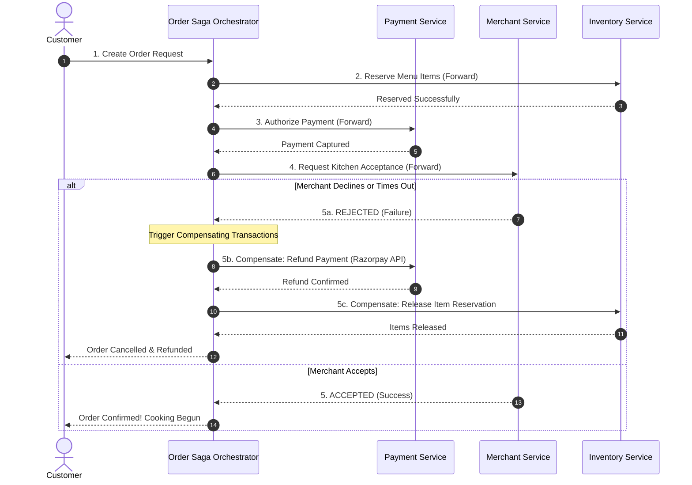
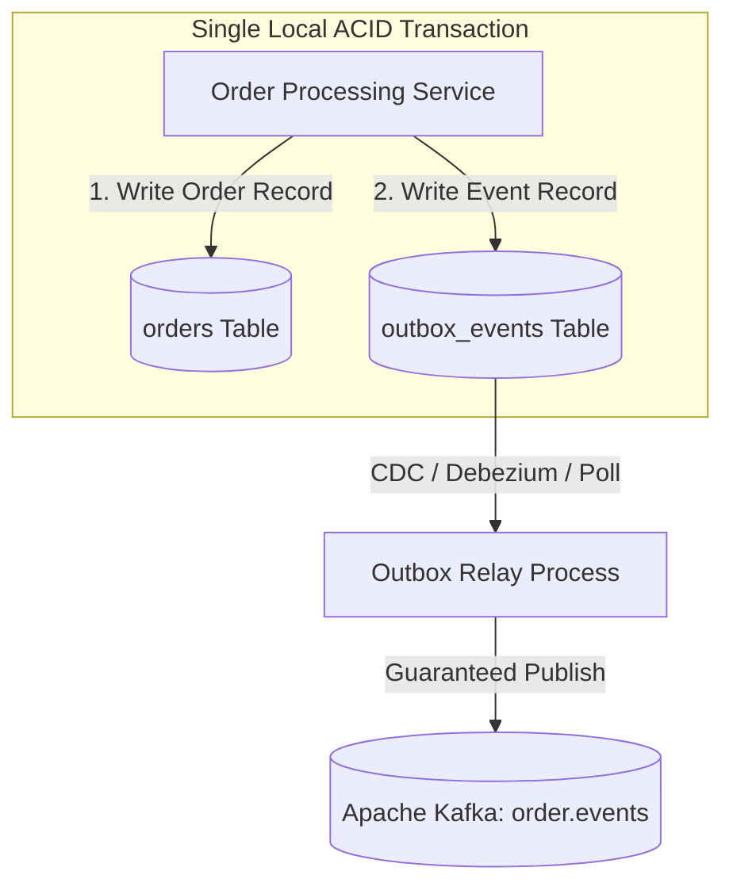

# 09 - Distributed Transactions: Saga Pattern & Transactional Outbox

## 1. Why Two-Phase Commit (2PC) Fails at Scale

In a traditional monolithic relational database, an order transaction spans multiple tables within a single ACID transaction. In a microservices architecture, data is partitioned across independent databases:
* `Order DB` (PostgreSQL)
* `Payment DB` (PostgreSQL / Third-party Gateway)
* `Inventory / Catalog DB` (PostgreSQL / Redis)
* `Fleet / Dispatch DB` (Redis / PostgreSQL)

Attempting to use **Two-Phase Commit (2PC)** across these microservices causes severe bottlenecks:
1. **Synchronous Resource Locking:** 2PC locks database rows across all services until the coordinator reaches consensus, causing thread exhaustion under high QPS.
2. **Coordinator SPOF:** If the 2PC coordinator crashes during the prepare phase, participating services hold locks indefinitely.
3. **Incompatibility with External Third Parties:** External payment gateways like Razorpay or Stripe cannot participate in internal XA/2PC transactions.

---

## 2. The Orchestrated Saga Pattern

The system implements the **Orchestrated Saga Pattern**. The **Order Saga Orchestrator** manages state transitions and executes forward actions or backward compensating transactions:



### Forward vs. Compensating Action Matrix:

| Step | Forward Action | Compensating Action (Rollback) |
| :---: | :--- | :--- |
| **1. Inventory** | Reserve dish stock / daily quota | Release dish stock back to active pool |
| **2. Promotions** | Lock coupon code (`usage_count + 1`) | Decrement coupon usage (`usage_count - 1`) |
| **3. Payment** | Capture charge from card / UPI | Execute full refund API call to gateway |
| **4. Kitchen** | Send order to kitchen screen | Remove order from kitchen ticket queue |
| **5. Fleet** | Dispatch delivery partner | Cancel dispatch request; return rider to pool |

---

## 3. The Transactional Outbox Pattern (Eliminating Dual-Write Bugs)

A common distributed systems bug is the **Dual-Write Hazard**: updating the local database and publishing an event to Apache Kafka in two separate operations. If the application server crashes between updating the database and sending the Kafka message, the database is modified, but downstream services never learn about the event.



### PostgreSQL Outbox Table DDL:
```sql
CREATE TABLE outbox_events (
    id UUID PRIMARY KEY DEFAULT gen_random_uuid(),
    aggregate_type VARCHAR(64) NOT NULL, -- e.g., 'ORDER'
    aggregate_id UUID NOT NULL,          -- e.g., order_id
    event_type VARCHAR(128) NOT NULL,    -- e.g., 'ORDER_PAYMENT_CONFIRMED'
    payload JSONB NOT NULL,
    created_at TIMESTAMP WITH TIME ZONE DEFAULT NOW(),
    processed BOOLEAN DEFAULT FALSE,
    processed_at TIMESTAMP WITH TIME ZONE
);

CREATE INDEX idx_outbox_unprocessed ON outbox_events(created_at) WHERE processed = FALSE;
```

A dedicated worker (or Debezium streaming PostgreSQL WAL logs) reads unprocessed events and pushes them to Kafka. If Kafka is temporarily down, the event remains safely stored in PostgreSQL until connectivity is restored, guaranteeing **At-Least-Once Delivery**.

---

## 4. Idempotency Keys: Zero Double-Billing Guarantee

To protect against duplicate payment charges caused by network drops or double-clicking:

1. The web client generates a unique UUID v4 string:
   ```http
   POST /api/v1/orders/checkout
   Idempotency-Key: 9b1deb4d-3b7d-4bad-9bdd-2b0d7b3dcb6d
   ```
2. The API Gateway or Checkout Service executes an atomic check-and-set in Redis:
   ```typescript
   const key = `idempotency:checkout:${idempotencyKey}`;
   const acquired = await redis.set(key, "PROCESSING", "EX", 120, "NX");

   if (!acquired) {
     // A request with this exact key is already in-flight or completed
     const existingResponse = await getCachedCheckoutResult(idempotencyKey);
     return res.status(200).json(existingResponse);
   }
   ```
3. If a network glitch causes the browser to re-transmit the request, the second call returns the cached response rather than processing a second payment charge.
