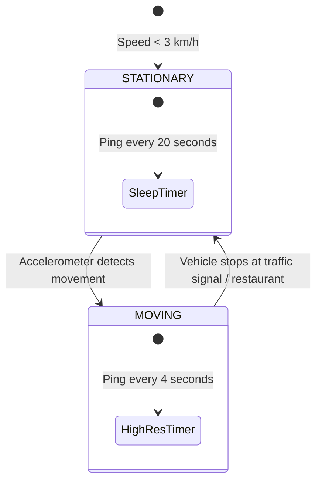

# 10 - Real-Time Location Tracking & WebSocket Pipeline

## 1. End-to-End Live Tracking Architecture

Real-time delivery tracking connects the moving delivery partner in traffic to the customer watching the web application map:

```mermaid
flowchart LR
    subgraph Delivery Partner
        RiderPhone[Rider Phone - GPS Chip] -->|MQTT Protocol / TLS| MQTTBroker[EMQX / MQTT Gateway]
    end

    subgraph Streaming & Processing Tier
        MQTTBroker -->|Kafka Producer| KafkaLocation[(Kafka Topic: rider.telemetry)]
        KafkaLocation --> TelemetryWorker[Go Telemetry Consumer]
        TelemetryWorker -->|GEOADD| RedisGeo[(Redis Geospatial Cache)]
        TelemetryWorker --> SnapRoad[Map Matching / Road Snapping]
    end

    subgraph Real-Time Broadcast Tier
        SnapRoad --> PubSub[(Redis Pub/Sub: order:{id}:channel)]
        PubSub --> WSGateway[WebSocket Gateway - Go / Node.js]
        WSGateway -->|WebSocket / SSE Stream| CustomerWeb[Customer Web App - Mapbox / Leaflet]
    end
```

---

## 2. Protocol Selection: WebSocket vs. Server-Sent Events (SSE)

For the customer web application, we evaluate WebSockets against Server-Sent Events (SSE):

| Parameter | Server-Sent Events (SSE) | WebSockets |
| :--- | :--- | :--- |
| **Directionality** | Unidirectional (Server $\rightarrow$ Client) | Full Duplex (Bi-directional) |
| **Transport** | Standard HTTP/2 or HTTP/1.1 | TCP Upgrade (`ws://` / `wss://`) |
| **Auto-Reconnection** | Native built-in browser reconnection | Requires custom client reconnect loop |
| **Firewall / Proxy Friendly**| 100% standard HTTP; no proxy blocking | Can be blocked by enterprise web proxies |
| **Our Decision** | **Recommended for Order Tracking** | Used for Merchant live interaction & Chat |

Because a customer tracking an order only needs to **consume updates** (rider location, ETA, state transitions) without continuously streaming data back to the server, **Server-Sent Events (SSE)** over HTTP/2 provides lower connection overhead and native browser reconnection.

---

## 3. Battery & Data Conservation: Adaptive Telemetry

Broadcasting GPS coordinates every 1 second drains a smartphone battery in less than 3 hours. Our rider application implements **Adaptive Telemetry Pings**:



* **When Stationary (at restaurant waiting for food):** Telemetry ping throttles down to **once every 20 seconds**.
* **When In Transit (speed > 10 km/h):** Telemetry ping increases to **once every 4 seconds**.
* **Significant Change Trigger:** An immediate ping is dispatched if the rider changes heading by $> 45^{\circ}$ even if the 4-second interval has not elapsed.

---

## 4. Client-Side Smooth Animation (Map Smoothing)

Instead of the delivery marker jumping abruptly across the map every 4 seconds, the Next.js web application implements **linear coordinate interpolation (LERP)** at 60 frames per second using `requestAnimationFrame`:

```typescript
// Web Client LERP Coordinate Smoother
export function animateMarkerBetweenCoordinates(
  marker: any,
  startCoord: [number, number], // [lng, lat]
  endCoord: [number, number],
  durationMs: number = 4000
) {
  const startTime = performance.now();

  function step(currentTime: number) {
    const elapsed = currentTime - startTime;
    const progress = Math.min(elapsed / durationMs, 1);

    // Linear interpolation formula
    const currentLng = startCoord[0] + (endCoord[0] - startCoord[0]) * progress;
    const currentLat = startCoord[1] + (endCoord[1] - startCoord[1]) * progress;

    marker.setLngLat([currentLng, currentLat]);

    if (progress < 1) {
      requestAnimationFrame(step);
    }
  }

  requestAnimationFrame(step);
}
```

---

## 5. High-Throughput WebSocket Gateway (Go Implementation)

The WebSocket Gateway in Go maintains 50,000+ persistent concurrent connections per node, leveraging lightweight goroutines:

```go
package main

import (
    "context"
    "fmt"
    "net/http"
    "github.com/gorilla/websocket"
    "github.com/redis/go-redis/v9"
)

var upgrader = websocket.Upgrader{
    CheckOrigin: func(r *http.Request) bool { return true },
}

func HandleOrderTrackWS(rdb *redis.Client) http.HandlerFunc {
    return func(w http.ResponseWriter, r *http.Request) {
        orderID := r.URL.Query().Get("order_id")
        conn, err := upgrader.Upgrade(w, r, nil)
        if err != nil {
            return
        }
        defer conn.Close()

        pubsub := rdb.Subscribe(context.Background(), fmt.Sprintf("order:%s:telemetry", orderID))
        defer pubsub.Close()

        ch := pubsub.Channel()
        for msg := range ch {
            // Push coordinates directly to browser over WebSocket
            if err := conn.WriteMessage(websocket.TextMessage, []byte(msg.Payload)); err != nil {
                break
            }
        }
    }
}
```
