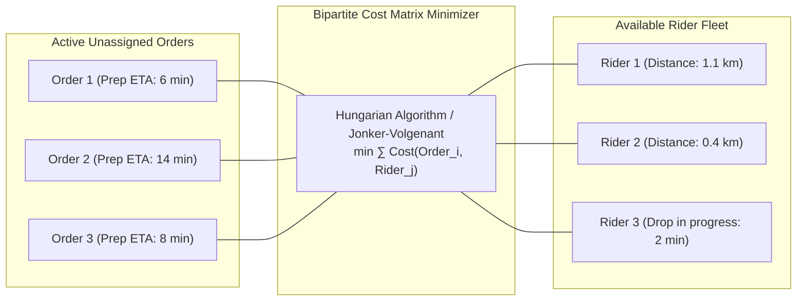
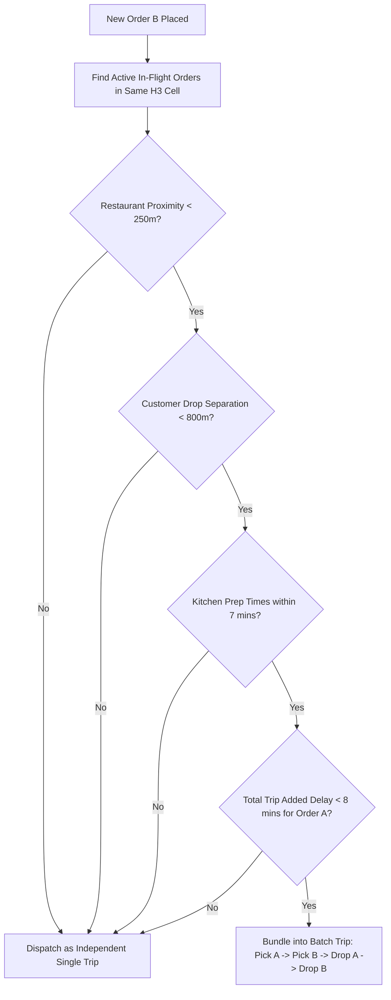

# 11 - Delivery Dispatch & Batching Engine

## 1. The Global Dispatch Optimization Problem

A naive dispatch system assigns the closest available delivery partner to an order as soon as it is placed (Greedy Nearest Neighbor). In real-world food logistics, this leads to catastrophic inefficiency:
* A rider arrives at a restaurant 20 minutes before the food is cooked (Idle Time).
* Riders criss-cross the city in opposing directions, driving fuel costs up and driver earnings down.

Instead, the **Dispatch Engine** aggregates orders and available delivery partners across a cluster over a rolling **30-second batching window**, solving a **Bipartite Matching Problem**:



---

## 2. Cost Function Formulation

The cost of assigning Order $i$ to Rider $j$ is calculated across multiple weighted penalties:

$$\text{Cost}(i, j) = w_1 \cdot T_{\text{travel}}(j \to \text{Rest}_i) + w_2 \cdot |T_{\text{arr}}(j) - T_{\text{prep}}(i)| + w_3 \cdot P_{\text{SLA}}(i) + w_4 \cdot (1 - R_{\text{rating}}(j))$$

Where:
* $T_{\text{travel}}(j \to \text{Rest}_i)$: Estimated travel time from rider’s current coordinate to the restaurant.
* $|T_{\text{arr}}(j) - T_{\text{prep}}(i)|$: **Synchronization Penalty**—minimizes rider wait time at the counter or food sitting cold.
* $P_{\text{SLA}}(i)$: Exponential penalty if the customer's promised delivery window is approaching expiration.
* $R_{\text{rating}}(j)$: Driver historical reliability score (assigns high-value orders to top-rated partners).
* Weights ($w_1, w_2, w_3, w_4$) are dynamically adjusted based on city-wide supply-demand pressure.

---

## 3. Order Batching Algorithm (2-Order Bundling)

To increase fleet productivity and lower customer delivery charges, the system combines compatible orders into a single delivery trip:



### The 4 Strict Batching Guardrails:
1. **Pickup Proximity:** The two restaurants must be within **250 meters** of each other (e.g., inside the same food court, mall, or street cluster).
2. **Delivery Proximity:** The two customer drop-off points must be within **800 meters** of each other or along the direct line of transit.
3. **Kitchen Sync:** The predicted food ready times must not differ by more than **7 minutes**, preventing Order A from going cold while waiting for Order B.
4. **First-Order SLA Guarantee:** The additional delay introduced to Customer A (due to picking and dropping Order B) must never exceed **8 minutes**.

---

## 4. Multi-Stop Route Optimization (TSP Heuristic)

Once two orders ($A$ and $B$) are batched, there are four possible route permutations:

```
Permutation 1: Pick A -> Pick B -> Drop A -> Drop B  (Standard)
Permutation 2: Pick A -> Pick B -> Drop B -> Drop A
Permutation 3: Pick A -> Drop A -> Pick B -> Drop B  (Sequential)
Permutation 4: Pick B -> Pick A -> Drop A -> Drop B
```

The dispatch service queries the Open Source Routing Machine (OSRM) distance matrix for all 4 permutations and selects the sequence with the **lowest total transit time that violates neither customer's promised SLA**.

---

## 5. Dispatch Architecture in Code

```typescript
// Core Dispatch Matching Interface
export interface DispatchCandidate {
  orderId: string;
  restaurantLat: number;
  restaurantLng: number;
  foodReadyTimestamp: number;
  promisedSlaTimestamp: number;
}

export interface RiderCandidate {
  riderId: string;
  currentLat: number;
  currentLng: number;
  isAvailable: boolean;
  activeTripRemainingSeconds: number;
}

export function computeAssignmentCost(
  order: DispatchCandidate,
  rider: RiderCandidate,
  travelTimeSec: number
): number {
  const currentTime = Date.now() / 1000;
  const riderArrivalTime = currentTime + travelTimeSec + rider.activeTripRemainingSeconds;
  
  // Wait time at restaurant (seconds)
  const waitTime = Math.max(0, order.foodReadyTimestamp - riderArrivalTime);
  // Cold food time (food ready before rider arrives)
  const coldFoodTime = Math.max(0, riderArrivalTime - order.foodReadyTimestamp);
  
  // Cost weights
  const W_TRAVEL = 1.0;
  const W_WAIT = 1.5;
  const W_COLD = 2.5; // High penalty for food sitting cold

  return (travelTimeSec * W_TRAVEL) + (waitTime * W_WAIT) + (coldFoodTime * W_COLD);
}
```
