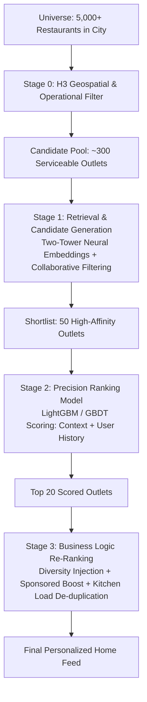
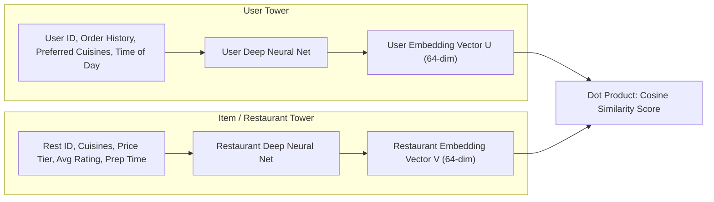

# 12 - Recommendation & Personalization Engine

## 1. Multi-Stage Recommendation Funnel

Recommending food is fundamentally different from recommending movies on Netflix or products on Amazon:
* **Spatial Hard Constraint:** A user cannot order from a 5-star restaurant located 40 kilometers away. Candidates must strictly be within the user's active delivery geofence.
* **Temporal Context:** User preferences change drastically by hour (Coffee and Idli at 8:00 AM; Biryani at 1:30 PM; Desserts at 11:30 PM).
* **Operational Constraint:** Recommending a restaurant whose kitchen is already overloaded causes delivery delays and cancellations.

The system utilizes an industry-standard **3-Stage Recommendation Funnel**:



---

## 2. Stage 1: Two-Tower Vector Retrieval Architecture

Candidate generation employs a **Two-Tower Deep Neural Network**:
* **User Tower:** Encodes user demographic features, historical cuisine vectors, price tier affinity, and current time of day into a 64-dimensional embedding vector $\vec{U}$.
* **Restaurant / Dish Tower:** Encodes restaurant cuisine tags, average dish pricing, popularity score, and rating into a 64-dimensional embedding vector $\vec{V}$.



At query time, candidate retrieval is an approximate nearest neighbor (ANN) search computed in sub-10ms using vector indexes (FAISS or Milvus/Pgvector):

$$\text{Similarity Score} = \vec{U} \cdot \vec{V} = \sum_{k=1}^{64} U_k \cdot V_k$$

---

## 3. Real-Time Feature Store Architecture (Feast / Redis)

To make personalized predictions within 80 milliseconds, features are decoupled into **Offline (Batch)** and **Online (Real-Time)** tiers:

```mermaid
flowchart TD
    subgraph Offline Feature Pipeline (Apache Spark / BigQuery)
        DataWarehouse[(Data Warehouse)] --> SparkJob[Daily Batch Spark Job]
        SparkJob --> User90DayStats[User 90-Day Order Freq, Cuisine Affinities]
        SparkJob --> RestHistoricSLA[Restaurant 30-Day Avg Prep Time]
    end

    subgraph Online Real-Time Feature Pipeline (Kafka / Flink)
        Clickstream[Live App Clicks & Views] --> Flink[Apache Flink Stream Job]
        Flink --> RecentClicks[User Clicks in Last 15 Mins: 'Biryani']
        Flink --> LiveKitchenLoad[Active Orders in Kitchen Right Now]
    end

    User90DayStats & RestHistoricSLA --> RedisStore[(Online Feature Store: Redis / Feast)]
    RecentClicks & LiveKitchenLoad --> RedisStore
    RedisStore --> ModelInference[Recommendation Model Inference Engine]
```

* **Batch Features:** Updated nightly in Redis (e.g., *User vegetarian probability: 0.94*, *User avg order value: ₹380*).
* **Streaming Features:** Updated sub-second in Redis (e.g., *User has clicked 3 North Indian restaurants in the past 8 minutes*).

---

## 4. Solving the Cold Start Problem

### For New Users (Zero Order History):
1. **Location-Based Popularity Baseline:** Recommend top-rated restaurants within the user's specific H3 hexagon cell with the highest re-order rates.
2. **Contextual Dayparting:** Serve time-appropriate collections (e.g., "Trending Breakfast Places" at 8:30 AM).
3. **Implicit Onboarding Signals:** The first dish searched or category clicked immediately re-weights the entire home feed for that session.

### For New Restaurants (Zero Orders / Zero Reviews):
1. **Exploration vs. Exploitation ($\epsilon$-Greedy Bandits):** Allocate 5% to 10% of high-visibility feed impressions to newly onboarded restaurants.
2. **Tag Matching:** Match the new restaurant’s cuisine embeddings with users whose past order embeddings show high affinity for that cuisine.
