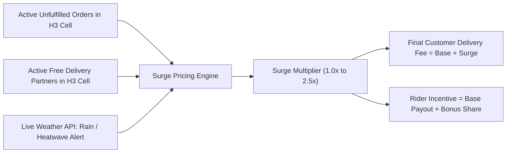
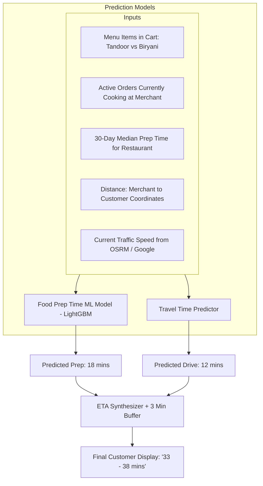

# 13 - Dynamic Pricing, Surge & ETA Engine

## 1. Dynamic Surge Pricing Architecture

Delivery supply (active delivery partners on the road) and consumer demand (active carts being checked out) are volatile. During Friday evening dinners, thunderstorms, or festival holidays, demand can exceed supply by $5\times$. Without pricing adjustments, orders queue indefinitely and food is delivered cold.

Surge pricing achieves two mathematical goals:
1. **Demand Cooling:** Encourages price-sensitive consumers to wait or order later.
2. **Supply Influx:** Incentivizes delivery partners to log online and drive toward high-demand hexagonal zones due to higher trip earnings.



---

## 2. Mathematical Formulation of Surge

The total delivery fee charged to the customer is formulated as:

$$\text{Delivery Fee} = \Big( \text{Base Fee} + \big( \text{Distance} \times \text{PerKm Rate} \big) \Big) \times S_{\text{total}}$$

Where the dynamic multiplier $S_{\text{total}}$ is bounded:

$$S_{\text{total}} = \min \Big( S_{\text{cap}}, \; 1.0 + \alpha \cdot \max\left(0, \frac{D - \theta \cdot S}{S}\right) + W_{\text{rain}} \Big)$$

* $D$: Number of active unfulfilled orders within the H3 Resolution 7 cell.
* $S$: Number of available delivery partners within the cell.
* $\theta$: Equilibrium capacity factor (typically $1.2$ orders per rider).
* $\alpha$: Price elasticity sensitivity coefficient ($0.25$).
* $W_{\text{rain}}$: Additive weather penalty ($+0.4$ for moderate rain, $+0.8$ for severe downpours).
* $S_{\text{cap}}$: **Hard regulatory/ethical cap (e.g., $2.5\times$)** to prevent price gouging.

---

## 3. Dynamic ETA Engine: The "Promise" Algorithm

The estimated time of arrival (ETA) displayed on the restaurant card before the customer orders must be accurate to within $\pm 4$ minutes.

$$\text{Total ETA} = \text{FPT}_{\text{predicted}} + \text{Transit}_{\text{predicted}} + \text{Buffer}_{\text{handoff}}$$



---

## 4. Production Code Implementation: Surge & ETA Computation

```typescript
export interface CellSupplyDemand {
  h3Index: string;
  activeOrders: number;
  availableRiders: number;
  isRaining: boolean;
  rainIntensityMmHr: number;
}

export class DynamicPricingEngine {
  private static readonly BASE_DELIVERY_FEE = 25.0; // ₹25 Base
  private static readonly PER_KM_RATE = 10.0;       // ₹10 per km beyond 2km
  private static readonly MAX_SURGE_MULTIPLIER = 2.5;

  public static calculateDeliveryCharge(
    distanceKm: number,
    telemetry: CellSupplyDemand
  ): { totalFee: number; surgeMultiplier: number; surgeFee: number } {
    // 1. Calculate Base Distance Fee
    const chargeableKm = Math.max(0, distanceKm - 2.0);
    const standardFee = this.BASE_DELIVERY_FEE + (chargeableKm * this.PER_KM_RATE);

    // 2. Compute Supply-Demand Ratio
    const safeRiders = Math.max(1, telemetry.availableRiders);
    const deficitRatio = (telemetry.activeOrders - (1.2 * safeRiders)) / safeRiders;
    
    let surgeMultiplier = 1.0;
    if (deficitRatio > 0) {
      surgeMultiplier += deficitRatio * 0.25;
    }

    // 3. Add Weather Penalty
    if (telemetry.isRaining) {
      const rainFactor = telemetry.rainIntensityMmHr > 10 ? 0.8 : 0.4;
      surgeMultiplier += rainFactor;
    }

    // 4. Enforce Hard Cap
    surgeMultiplier = Math.min(this.MAX_SURGE_MULTIPLIER, Math.max(1.0, surgeMultiplier));

    // 5. Compute Final Pricing
    const totalFee = Math.round(standardFee * surgeMultiplier);
    const surgeFee = totalFee - Math.round(standardFee);

    return {
      totalFee,
      surgeMultiplier: parseFloat(surgeMultiplier.toFixed(2)),
      surgeFee
    };
  }
}
```
