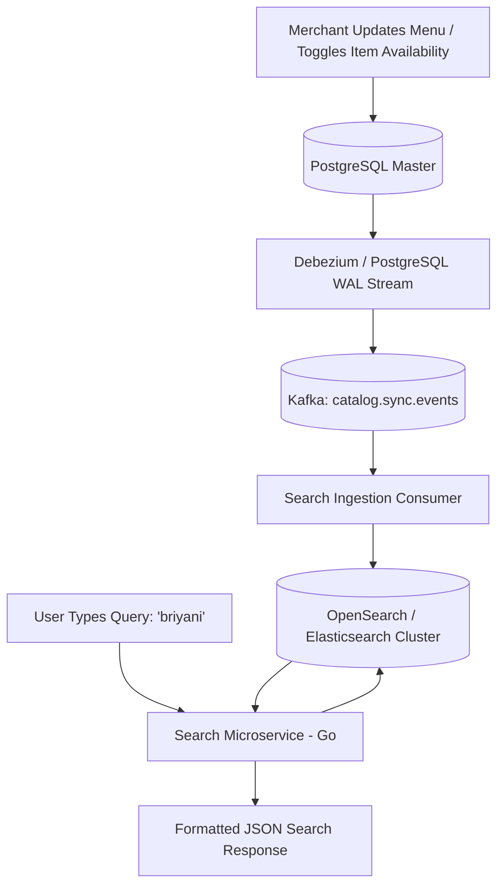

# 14 - Search Catalog & Fuzzy Matching Engine

## 1. Search Domain Architecture & Ingestion Pipeline

The Search Service powers discovery for dishes, restaurants, cuisines, and dietary filters across thousands of active menus:



---

## 2. Elasticsearch Index Mapping & Analyzers

Below is the production-grade OpenSearch index mapping, featuring custom **Edge-Ngram** tokenizers for autocomplete and **Double Metaphone** phonetic filters:

```json
{
  "settings": {
    "number_of_shards": 3,
    "number_of_replicas": 2,
    "analysis": {
      "filter": {
        "autocomplete_filter": {
          "type": "edge_ngram",
          "min_gram": 2,
          "max_gram": 15
        },
        "food_synonym_filter": {
          "type": "synonym",
          "synonyms": [
            "coke, coca cola, pepsi, cold drink, soda",
            "paneer, panir, cottage cheese",
            "biryani, briyani, biriyani",
            "roti, chapati, phulka, flatbread"
          ]
        },
        "phonetic_filter": {
          "type": "phonetic",
          "encoder": "double_metaphone",
          "replace": false
        }
      },
      "analyzer": {
        "food_autocomplete": {
          "type": "custom",
          "tokenizer": "standard",
          "filter": ["lowercase", "food_synonym_filter", "autocomplete_filter"]
        },
        "food_search": {
          "type": "custom",
          "tokenizer": "standard",
          "filter": ["lowercase", "food_synonym_filter", "phonetic_filter"]
        }
      }
    }
  },
  "mappings": {
    "properties": {
      "id": { "type": "keyword" },
      "restaurant_id": { "type": "keyword" },
      "restaurant_name": { 
        "type": "text", 
        "analyzer": "food_autocomplete", 
        "search_analyzer": "food_search" 
      },
      "dish_name": { 
        "type": "text", 
        "analyzer": "food_autocomplete", 
        "search_analyzer": "food_search" 
      },
      "cuisine_tags": { "type": "keyword" },
      "is_veg": { "type": "boolean" },
      "price": { "type": "integer" },
      "is_available": { "type": "boolean" },
      "location": { "type": "geo_point" },
      "rating": { "type": "float" },
      "h3_index": { "type": "keyword" }
    }
  }
}
```

---

## 3. The Multi-Match Query with Gaussian Distance Decay

When a user searches for *"chicken roll"*, the search query scores documents using field boosting and applies a **Gaussian distance decay function** so that delicious food 2 km away ranks above an identical dish 9 km away:

```json
{
  "query": {
    "function_score": {
      "query": {
        "bool": {
          "must": [
            {
              "multi_match": {
                "query": "chicken roll",
                "fields": [
                  "restaurant_name^5",
                  "dish_name^3",
                  "cuisine_tags^2"
                ],
                "fuzziness": "AUTO",
                "prefix_length": 2
              }
            }
          ],
          "filter": [
            { "term": { "is_available": true } },
            { "geo_distance": { "distance": "7km", "location": { "lat": 28.6139, "lon": 77.2090 } } }
          ]
        }
      },
      "functions": [
        {
          "gauss": {
            "location": {
              "origin": { "lat": 28.6139, "lon": 77.2090 },
              "scale": "3km",
              "decay": 0.5
            }
          },
          "weight": 2.0
        },
        {
          "field_value_factor": {
            "field": "rating",
            "factor": 1.2,
            "modifier": "sqrt",
            "missing": 3.0
          },
          "weight": 1.5
        }
      ],
      "score_mode": "multiply",
      "boost_mode": "multiply"
    }
  }
}
```

---

## 4. Query Intent Classification & Fast Autocomplete (Typeahead)

1. **Sub-15ms Autocomplete:**
   * Handled by Edge-Ngram indices stored in Redis Trie memory or Elasticsearch with `size: 8`.
   * Displays instant recommendations as the user types: `b` $\to$ *Biryani*, *Burger King*, *Behrouz Biryani*.
2. **Intent Parsing:**
   * If the query matches a brand (e.g., *"KFC"*), navigate the user directly to the restaurant's menu page.
   * If the query matches a category (e.g., *"Pizza"*), display a sorted dish grid across all participating local pizzerias.
