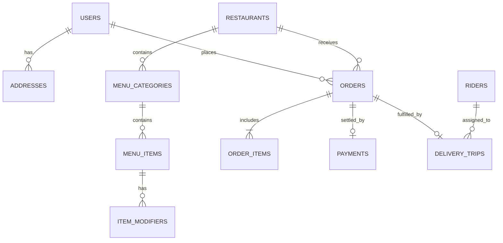

# 15 - Complete PostgreSQL Database Schema (DDL & ER Models)

## 1. Entity Relationship Overview

The core relational database layer is modeled in **PostgreSQL 15+** with the **PostGIS** extension for geospatial geometries:



---

## 2. Production PostgreSQL DDL Script

```sql
-- Enable necessary extensions
CREATE EXTENSION IF NOT EXISTS "uuid-ossp";
CREATE EXTENSION IF NOT EXISTS "postgis";

-- ENUMS
CREATE TYPE user_role AS ENUM ('CUSTOMER', 'MERCHANT', 'RIDER', 'ADMIN');
CREATE TYPE order_status AS ENUM (
    'CREATED', 'PAYMENT_PENDING', 'PAYMENT_CONFIRMED', 'PAYMENT_FAILED',
    'MERCHANT_NOTIFIED', 'MERCHANT_ACCEPTED', 'MERCHANT_REJECTED',
    'KITCHEN_PREPARING', 'FOOD_READY', 'RIDER_ASSIGNED',
    'RIDER_AT_RESTAURANT', 'ORDER_PICKED_UP', 'OUT_FOR_DELIVERY',
    'RIDER_AT_DOORSTEP', 'DELIVERED', 'CANCELLED'
);
CREATE TYPE payment_status AS ENUM ('INITIATED', 'AUTHORIZED', 'CAPTURED', 'FAILED', 'REFUNDED');
CREATE TYPE trip_status AS ENUM ('ASSIGNED', 'ARRIVED_AT_STORE', 'PICKED_UP', 'ARRIVED_AT_CUSTOMER', 'COMPLETED', 'FAILED');

-- 1. USERS TABLE
CREATE TABLE users (
    id UUID PRIMARY KEY DEFAULT gen_random_uuid(),
    phone_number VARCHAR(15) UNIQUE NOT NULL,
    email VARCHAR(255) UNIQUE,
    full_name VARCHAR(128) NOT NULL,
    role user_role DEFAULT 'CUSTOMER',
    is_active BOOLEAN DEFAULT TRUE,
    created_at TIMESTAMP WITH TIME ZONE DEFAULT NOW(),
    updated_at TIMESTAMP WITH TIME ZONE DEFAULT NOW()
);

-- 2. ADDRESSES TABLE
CREATE TABLE addresses (
    id UUID PRIMARY KEY DEFAULT gen_random_uuid(),
    user_id UUID NOT NULL REFERENCES users(id) ON DELETE CASCADE,
    address_label VARCHAR(32) DEFAULT 'Home', -- Home, Work, Other
    formatted_address TEXT NOT NULL,
    house_or_flat_number VARCHAR(64),
    landmark VARCHAR(128),
    coordinates GEOMETRY(Point, 4326) NOT NULL,
    h3_res8 VARCHAR(15) NOT NULL,
    is_default BOOLEAN DEFAULT FALSE,
    created_at TIMESTAMP WITH TIME ZONE DEFAULT NOW()
);
CREATE INDEX idx_addresses_user ON addresses(user_id);
CREATE INDEX idx_addresses_geo ON addresses USING GIST(coordinates);

-- 3. RESTAURANTS TABLE
CREATE TABLE restaurants (
    id UUID PRIMARY KEY DEFAULT gen_random_uuid(),
    owner_user_id UUID NOT NULL REFERENCES users(id),
    name VARCHAR(255) NOT NULL,
    slug VARCHAR(255) UNIQUE NOT NULL,
    fssai_license_number VARCHAR(32) NOT NULL,
    phone_number VARCHAR(15) NOT NULL,
    email VARCHAR(255),
    coordinates GEOMETRY(Point, 4326) NOT NULL,
    h3_res8 VARCHAR(15) NOT NULL,
    address_text TEXT NOT NULL,
    rating_avg NUMERIC(3, 2) DEFAULT 0.00,
    rating_count INT DEFAULT 0,
    cost_for_two INT NOT NULL, -- In Rupee units (e.g. 350)
    is_pure_veg BOOLEAN DEFAULT FALSE,
    is_active BOOLEAN DEFAULT TRUE,
    is_accepting_orders BOOLEAN DEFAULT TRUE,
    opens_at TIME NOT NULL DEFAULT '08:00:00',
    closes_at TIME NOT NULL DEFAULT '23:00:00',
    created_at TIMESTAMP WITH TIME ZONE DEFAULT NOW()
);
CREATE INDEX idx_restaurants_h3 ON restaurants(h3_res8);
CREATE INDEX idx_restaurants_geo ON restaurants USING GIST(coordinates);

-- 4. MENU CATEGORIES & ITEMS
CREATE TABLE menu_categories (
    id UUID PRIMARY KEY DEFAULT gen_random_uuid(),
    restaurant_id UUID NOT NULL REFERENCES restaurants(id) ON DELETE CASCADE,
    name VARCHAR(128) NOT NULL,
    display_order INT DEFAULT 0,
    is_active BOOLEAN DEFAULT TRUE
);

CREATE TABLE menu_items (
    id UUID PRIMARY KEY DEFAULT gen_random_uuid(),
    restaurant_id UUID NOT NULL REFERENCES restaurants(id) ON DELETE CASCADE,
    category_id UUID NOT NULL REFERENCES menu_categories(id) ON DELETE CASCADE,
    name VARCHAR(255) NOT NULL,
    description TEXT,
    is_veg BOOLEAN DEFAULT TRUE,
    price INT NOT NULL, -- Represented in Rupee (or Paisa e.g. 25000 = ₹250.00)
    image_url TEXT,
    is_available BOOLEAN DEFAULT TRUE,
    prep_time_minutes INT DEFAULT 15,
    created_at TIMESTAMP WITH TIME ZONE DEFAULT NOW()
);
CREATE INDEX idx_menu_items_restaurant ON menu_items(restaurant_id) WHERE is_available = TRUE;

-- 5. RIDERS / FLEET TABLE
CREATE TABLE riders (
    id UUID PRIMARY KEY DEFAULT gen_random_uuid(),
    user_id UUID NOT NULL REFERENCES users(id) ON DELETE CASCADE,
    vehicle_type VARCHAR(32) DEFAULT 'BICYCLE', -- BICYCLE, MOTORCYCLE, EV
    vehicle_plate_number VARCHAR(32),
    current_coordinates GEOMETRY(Point, 4326),
    current_h3_res9 VARCHAR(15),
    is_online BOOLEAN DEFAULT FALSE,
    is_busy BOOLEAN DEFAULT FALSE,
    rating NUMERIC(3, 2) DEFAULT 5.00,
    created_at TIMESTAMP WITH TIME ZONE DEFAULT NOW()
);
CREATE INDEX idx_riders_geo ON riders USING GIST(current_coordinates);
CREATE INDEX idx_riders_h3 ON riders(current_h3_res9) WHERE is_online = TRUE AND is_busy = FALSE;

-- 6. ORDERS TABLE
CREATE TABLE orders (
    id UUID PRIMARY KEY DEFAULT gen_random_uuid(),
    customer_user_id UUID NOT NULL REFERENCES users(id),
    restaurant_id UUID NOT NULL REFERENCES restaurants(id),
    delivery_address_id UUID NOT NULL REFERENCES addresses(id),
    status order_status DEFAULT 'CREATED',
    subtotal_amount INT NOT NULL,
    delivery_charge INT NOT NULL DEFAULT 0,
    surge_charge INT NOT NULL DEFAULT 0,
    tax_amount INT NOT NULL DEFAULT 0,
    discount_amount INT NOT NULL DEFAULT 0,
    total_amount INT NOT NULL,
    delivery_otp VARCHAR(6),
    pickup_otp VARCHAR(6),
    customer_notes TEXT,
    row_version INT NOT NULL DEFAULT 1, -- Optimistic concurrency control
    created_at TIMESTAMP WITH TIME ZONE DEFAULT NOW(),
    updated_at TIMESTAMP WITH TIME ZONE DEFAULT NOW()
);
CREATE INDEX idx_orders_customer ON orders(customer_user_id, created_at DESC);
CREATE INDEX idx_orders_restaurant ON orders(restaurant_id, created_at DESC);
CREATE INDEX idx_orders_status ON orders(status);

-- 7. ORDER ITEMS TABLE
CREATE TABLE order_items (
    id UUID PRIMARY KEY DEFAULT gen_random_uuid(),
    order_id UUID NOT NULL REFERENCES orders(id) ON DELETE CASCADE,
    menu_item_id UUID NOT NULL REFERENCES menu_items(id),
    item_name VARCHAR(255) NOT NULL,
    quantity INT NOT NULL CHECK (quantity > 0),
    unit_price INT NOT NULL,
    total_price INT NOT NULL
);

-- 8. PAYMENTS TABLE
CREATE TABLE payments (
    id UUID PRIMARY KEY DEFAULT gen_random_uuid(),
    order_id UUID UNIQUE NOT NULL REFERENCES orders(id) ON DELETE CASCADE,
    gateway VARCHAR(32) NOT NULL, -- RAZORPAY, STRIPE
    gateway_order_id VARCHAR(128) NOT NULL,
    gateway_payment_id VARCHAR(128),
    amount INT NOT NULL,
    currency VARCHAR(8) DEFAULT 'INR',
    status payment_status DEFAULT 'INITIATED',
    idempotency_key VARCHAR(128) UNIQUE NOT NULL,
    created_at TIMESTAMP WITH TIME ZONE DEFAULT NOW(),
    updated_at TIMESTAMP WITH TIME ZONE DEFAULT NOW()
);

-- 9. DELIVERY TRIPS TABLE
CREATE TABLE delivery_trips (
    id UUID PRIMARY KEY DEFAULT gen_random_uuid(),
    order_id UUID UNIQUE NOT NULL REFERENCES orders(id),
    rider_id UUID NOT NULL REFERENCES riders(id),
    status trip_status DEFAULT 'ASSIGNED',
    batch_group_id UUID, -- Grouped if batched with another order
    pickup_distance_meters INT,
    dropoff_distance_meters INT,
    assigned_at TIMESTAMP WITH TIME ZONE DEFAULT NOW(),
    picked_up_at TIMESTAMP WITH TIME ZONE,
    delivered_at TIMESTAMP WITH TIME ZONE
);
CREATE INDEX idx_trips_rider ON delivery_trips(rider_id);
```
