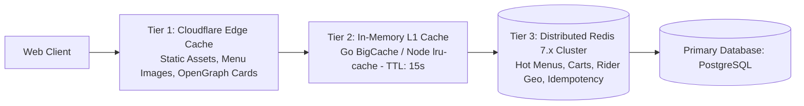

# 17 - Caching Tier: Redis Cluster & In-Memory Strategies

## 1. Multi-Tier Caching Topology

To maintain sub-100ms API responses under peak load (5,000+ QPS), the platform implements a three-tier caching strategy:



---

## 2. Redis Data Structures & Key Namespace Design

| Namespace / Key Pattern | Redis Data Type | TTL | Purpose / Usage |
| :--- | :---: | :---: | :--- |
| `menu:restaurant:{id}` | `STRING` (Compressed JSON) | 6 hours | Pre-serialized full menu tree. Invalidated on merchant edit. |
| `cart:user:{id}` | `HASH` | 48 hours | Active shopping cart items and quantities: `HSET cart:user:101 item:45 2`. |
| `idempotency:{key}` | `STRING` | 24 hours | Prevents double-charges during checkout calls. |
| `h3:riders:res9:{h3}` | `SET` | 45 seconds | Active rider IDs within this specific hexagon cell. |
| `geo:riders:active` | `GEO` (Sorted Set) | Live | Continuous coordinates: `GEOADD geo:riders:active lng lat rider_id`. |
| `rate_limit:ip:{ip}` | `STRING` (Integer Counter) | 60 seconds | Token bucket rate limiting: `INCR` + `EXPIRE`. |
| `coupon:usage:{code}` | `STRING` (Counter) | Campaign Duration | Atomic usage tracking to prevent over-redemption. |

---

## 3. Cache Invalidation Patterns

### Cache-Aside (Lazy Loading) with Proactive Eviction:
1. **On Read:** 
   * Check L1 in-memory cache. If hit, return immediately (< 1ms).
   * Check Redis cluster. If hit, populate L1 and return (< 10ms).
   * If miss, query PostgreSQL, serialize to JSON, write to Redis with jittered TTL, and return.
2. **On Write (Merchant edits dish price from ₹250 to ₹270):**
   * Update PostgreSQL inside an ACID transaction.
   * Proactively execute `DEL menu:restaurant:{id}` in Redis.
   * Publish an invalidation event to Redis Pub/Sub so all application instances clear their local L1 caches within 50ms.

---

## 4. Production Lua Script: Atomic Inventory & Flash Quota Reservation

When a restaurant only has 10 portions of a limited dish remaining, thousands of users might attempt to buy it simultaneously. Standard read-then-write creates race conditions. This is solved with an **Atomic Redis Lua Script**:

```lua
-- KEYS[1]: Item Stock Key (e.g., 'stock:item:9921')
-- ARGV[1]: Requested Quantity (e.g., 2)

local current_stock = redis.call('GET', KEYS[1])

if not current_stock then
    -- Key does not exist, item is un-metered
    return 1
end

local stock_num = tonumber(current_stock)
local request_qty = tonumber(ARGV[1])

if stock_num >= request_qty then
    -- Deduct stock atomically
    redis.call('DECRBY', KEYS[1], request_qty)
    return 1 -- SUCCESS
else
    -- Insufficient inventory
    return 0 -- REJECTED
end
```

---

## 5. Redis Cluster Sizing & High Availability

* **Topology:** 6-node Redis cluster (3 Masters, 3 Replicas) with automated failover via Redis Sentinel / Cluster Bus.
* **Eviction Policy:** `volatile-lru` (Evicts keys with an explicit expiration first when memory reaches 80% saturation).
* **Persistence Strategy:** AOF (Append-Only File) configured with `everysec` for near-zero data loss on crash without blocking throughput.
