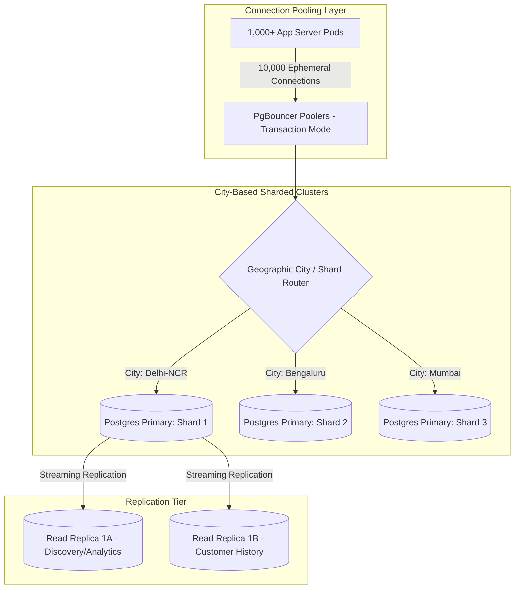

# 18 - Database Partitioning, Sharding & Replication

## 1. Database Scaling Bottlenecks

In high-throughput food delivery, databases encounter three primary failure modes:
1. **Connection Exhaustion:** PostgreSQL spawns a new OS process per connection. Having 2,000 web server instances connecting directly exhausts server memory and crashes PostgreSQL.
2. **Table Bloat & Index Degradation:** An `orders` table with 20 million rows causes B-Tree indexes to exceed RAM capacity, causing slow disk reads.
3. **Cross-City Interference:** A massive flash sale in Delhi should never degrade database performance for users ordering in Mumbai.



---

## 2. Why Geographic Sharding (`city_id`) is Optimal

Unlike social networks (where a user in India follows someone in California, requiring complex cross-shard joins), **food delivery is fundamentally localized**:
* A customer in Connaught Place, Delhi only interacts with restaurants and riders within Delhi.
* 99.8% of all operational queries (`INSERT order`, `UPDATE rider_location`, `SELECT menu`) are localized to a single city.

### Sharding Key Formulation:
All major operational tables include `city_id` in their composite primary key:
```sql
PRIMARY KEY (id, city_id)
```
The shard router routes queries directly to the designated database shard based on `city_id`, completely eliminating distributed cross-shard transactions.

---

## 3. PostgreSQL Table Partitioning (Declarative Time Range)

Historical orders older than 60 days are rarely accessed in the critical operational path. The `orders` table is partitioned by date using **Declarative Range Partitioning**:

```sql
-- Master Partitioned Orders Table
CREATE TABLE orders (
    id UUID NOT NULL DEFAULT gen_random_uuid(),
    city_id INT NOT NULL,
    customer_user_id UUID NOT NULL,
    restaurant_id UUID NOT NULL,
    total_amount INT NOT NULL,
    status order_status NOT NULL,
    created_at TIMESTAMP WITH TIME ZONE NOT NULL DEFAULT NOW(),
    PRIMARY KEY (id, created_at)
) PARTITION BY RANGE (created_at);

-- Monthly Partitions
CREATE TABLE orders_2026_10 PARTITION OF orders
    FOR VALUES FROM ('2026-10-01 00:00:00+00') TO ('2026-11-01 00:00:00+00');

CREATE TABLE orders_2026_11 PARTITION OF orders
    FOR VALUES FROM ('2026-11-01 00:00:00+00') TO ('2026-12-01 00:00:00+00');
```

### Operational Benefits:
1. **Index Optimization:** Indexes for `orders_2026_10` stay fully resident in RAM (cache), accelerating write and query throughput.
2. **Zero-Downtime Archival:** Archiving 2-year-old orders to cold S3 storage is as simple as running `ALTER TABLE orders DETACH PARTITION orders_2024_01;`—requiring zero locking on the live table.

---

## 4. Connection Pooling with PgBouncer (Transaction Pooling)

```ini
; pgbouncer.ini Configuration
[databases]
food_platform_db = host=10.0.1.10 port=5432 dbname=production_orders

[pgbouncer]
listen_port = 6432
listen_addr = *
auth_type = scram-sha-256
pool_mode = transaction
max_client_conn = 15000
default_pool_size = 50
min_pool_size = 10
reserve_pool_size = 10
reserve_pool_timeout = 5
max_db_connections = 100
```

By configuring PgBouncer in **`transaction` mode**, thousands of client connections share a tight pool of just 50–100 physical PostgreSQL backend connections. As soon as a transaction commits, the connection is instantly returned to the pool for the next waiting query.
