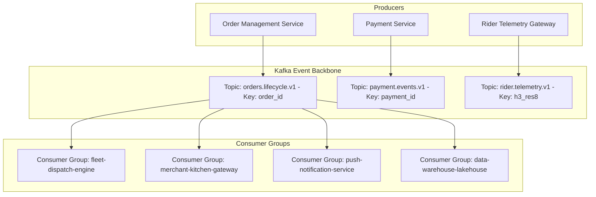
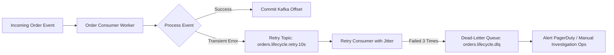

# 19 - Kafka Event-Driven Architecture & Topic Topology

## 1. Asynchronous Event-Driven Paradigm

Synchronous HTTP calls between microservices create tight coupling. If the Notification Service slows down, the entire checkout pipeline stalls. Apache Kafka serves as the **high-throughput asynchronous backbone**, decoupling event producers from consumers:



---

## 2. Topic Taxonomy & Partition Key Strategy

Partition keys are critical in Kafka: **messages with the same partition key are guaranteed to land on the same partition and be processed in strict FIFO chronological order**.

| Topic Name | Partition Key | Retention | Partitions | Purpose |
| :--- | :--- | :---: | :---: | :--- |
| `orders.lifecycle.v1` | `order_id` (UUID) | 7 Days | 32 | All state transitions (`CREATED`, `ACCEPTED`, `DELIVERED`). |
| `rider.telemetry.v1` | `h3_res8` (String) | 4 Hours | 64 | GPS pings. Partitioning by H3 groups local riders on the same node. |
| `merchant.events.v1` | `restaurant_id` (UUID)| 3 Days | 16 | Kitchen availability toggles and prep-time updates. |
| `payments.events.v1` | `order_id` (UUID) | 30 Days | 16 | Payment authorization, captures, and refund confirmations. |

### Why Partition by `order_id`?
If `ORDER_CREATED` landed on Partition 1 and `ORDER_CANCELLED` landed on Partition 2, a consumer processing Partition 2 faster might attempt to cancel an order before it has even been created in the database. Partitioning by `order_id` guarantees that every event for Order X is processed sequentially by the exact same consumer thread.

---

## 3. Dead-Letter Queues (DLQ) & Error Handling

When a consumer encounters a malformed payload or an unrecoverable third-party error, it must not block the entire Kafka partition:



1. **Retry Topics:** Events that fail due to temporary network timeouts are routed to a delayed retry topic (`orders.lifecycle.retry.10s`) with exponential backoff.
2. **Dead-Letter Queue (DLQ):** If an event fails after 3 retries, it is pushed to `orders.lifecycle.dlq`. An alert is dispatched to the engineering team without halting the partition's message stream.

---

## 4. Schema Governance: Protobuf & Schema Registry

To prevent producers from publishing breaking schema modifications (e.g., renaming a JSON field from `orderId` to `id`), all Kafka topics enforce strict serialization via **Confluent Schema Registry** with **Full Compatibility**:

```protobuf
syntax = "proto3";

package events.orders.v1;

message OrderLifecycleEvent {
  string event_id = 1;
  string order_id = 2;
  string event_type = 3; // 'PAYMENT_CONFIRMED', 'MERCHANT_ACCEPTED', etc.
  int64 timestamp_epoch_ms = 4;
  
  message OrderDetails {
    string customer_id = 1;
    string restaurant_id = 2;
    int32 total_amount_inr = 3;
    string delivery_address_h3 = 4;
  }
  
  OrderDetails details = 5;
}
```
Producers compiling without the registered protobuf schema are rejected at the Kafka broker boundary.
