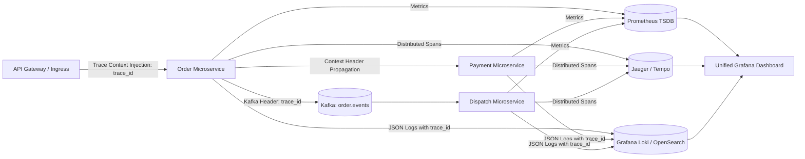
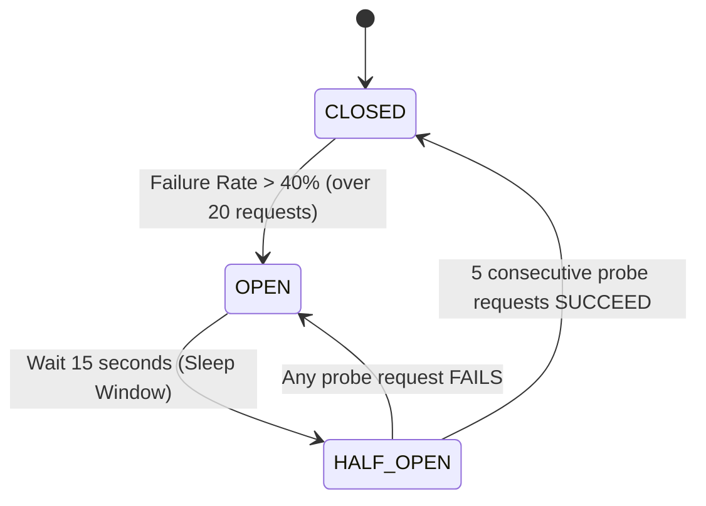

# 20 - Observability, Resilience & Circuit Breakers

## 1. The Three Pillars of Observability

In a distributed food delivery architecture with dozens of microservices, troubleshooting an order failure requires unified telemetry:



### 1. Metrics (The 4 Golden Signals)
* **Latency:** Tracked at p50, p95, and p99 percentiles for every API endpoint.
* **Traffic:** Requests per second (QPS) per microservice.
* **Errors:** HTTP 5xx error rates and unhandled exception counters.
* **Saturation:** CPU, memory utilization, and PostgreSQL/Redis connection pool saturation.

### 2. Distributed Tracing (OpenTelemetry & Jaeger)
Every incoming request at the API Gateway is tagged with a unique `traceparent` (W3C standard header). This trace ID is forwarded through every HTTP/gRPC call and embedded into Kafka record headers. An engineer can inspect a single trace in Jaeger and see the exact millisecond breakdown across all 7 microservices involved in placing that order.

### 3. Structured Logging (Correlation IDs)
All services log in structured JSON with standardized fields:
```json
{
  "timestamp": "2026-10-19T03:00:15.120Z",
  "level": "ERROR",
  "service": "payment-service",
  "trace_id": "4bf92f3577b34da6a3ce929d0e0e4736",
  "order_id": "d3b07384-d113-4a44-a035-7c08b292e74e",
  "user_id": "8902b112-998a-4d22-b912-33a876d2e110",
  "message": "Payment gateway timeout after 3000ms",
  "gateway": "RAZORPAY"
}
```

---

## 2. Circuit Breaker Architecture (Resilience4j & Envoy)

When a downstream dependency (such as an external SMS provider, recommendation engine, or payment gateway) begins failing, a **Circuit Breaker** prevents cascading failures:



### Circuit Breaker Configuration in Practice:
```yaml
resilience4j.circuitbreaker:
  instances:
    recommendationService:
      slidingWindowType: COUNT_BASED
      slidingWindowSize: 50
      minimumNumberOfCalls: 20
      failureRateThreshold: 50.0 # Open if 50% calls fail
      slowCallRateThreshold: 50.0
      slowCallDurationThreshold: 500ms # Call is slow if > 500ms
      waitDurationInOpenState: 10000ms
      permittedNumberOfCallsInHalfOpenState: 5
      automaticTransitionFromOpenToHalfOpenEnabled: true
```

* **When Open:** Calls to the recommendation service are instantly aborted (fail-fast within 0.1ms). The API gateway immediately returns the static cached fallback feed, protecting the user experience and preventing server thread saturation.

---

## 3. Bulkhead Isolation Pattern

Bulkheads physically isolate resources (thread pools, memory, and database connections) so that a failure in one non-critical domain does not sink the critical order placement ship:

* **Critical Order Placement Pool:** Dedicated pool of 200 execution threads and 40 database connections.
* **Secondary Review & Rating Pool:** Dedicated pool of 30 execution threads and 5 database connections.
* **Analytical Clickstream Pool:** Asynchronous background non-blocking queue.

Even if 100,000 users simultaneously submit restaurant reviews, the review service's database pool maxes out independently, leaving the critical order checkout pool completely untouched.
