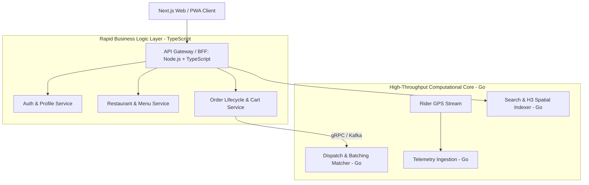

# 23 - Backend Tech Stack Decision Matrix

## 1. Programming Language & Framework Comparison

Selecting the right runtime environment dictates developer velocity, infrastructure cost, and system throughput:

| Parameter | Node.js (TypeScript) | Go (Golang) | Java (Spring Boot) | Python (FastAPI) |
| :--- | :---: | :---: | :---: | :---: |
| **Development Velocity** | **Very High** | High | Moderate | Very High |
| **Type Safety** | High (TypeScript) | Very High (Static) | Very High (Static) | Moderate (Type hints) |
| **Raw Concurrency Throughput**| Moderate (Event Loop) | **Extreme (Goroutines)** | Very High (Virtual Threads) | Low (GIL constraints) |
| **Memory Footprint** | ~120 MB / pod | **~15–25 MB / pod** | ~350–600 MB / pod | ~150 MB / pod |
| **Cold Start Duration** | ~400 ms | **< 30 ms** | ~2,500–5,000 ms | ~600 ms |
| **Shared Frontend Types** | **Yes (Full-Stack TS)** | No | No | No |

---

## 2. The Pragmatic Polyglot Strategy

For a modern high-scale startup, an all-or-nothing approach is inefficient. We adopt a **Two-Tier Polyglot Architecture**:

### Tier 1: Node.js / TypeScript (Fastify / NestJS)
* **Applied to:** API Gateway, BFF, Authentication, Catalog Management, and Cart.
* **Why:** Enables end-to-end type safety between the Next.js frontend and backend. DTOs and API contract schemas are defined once (via Zod or Prisma) and shared across client and server.

### Tier 2: Go (Golang)
* **Applied to:** Live Rider Telemetry Ingestion, H3 Geospatial lookups, and the Algorithmic Dispatch Engine.
* **Why:** Ingesting 5,000 GPS pings per second in Node.js creates event-loop garbage collection pauses. Go’s lightweight goroutines handle 100,000 concurrent network streams with negligible memory overhead and sub-millisecond execution times.

---

## 3. Database & Message Queue Technology Choices

| Role | Selected Technology | Alternative Considered | Decision Rationale |
| :--- | :--- | :--- | :--- |
| **Relational Database** | **PostgreSQL 15+** | MySQL / MariaDB | Superior JSONB support, native PostGIS spatial extension, declarative table partitioning, and rock-solid ACID transactions. |
| **Distributed Cache** | **Redis 7.x** | Memcached / Aerospike | Built-in geospatial commands (`GEOADD`, `GEOSEARCH`), Pub/Sub, sorted sets, and atomic Lua scripting capabilities. |
| **Message Streaming** | **Apache Kafka** | RabbitMQ / AWS SQS | Replayable immutable event log, strict FIFO partition ordering by `order_id`, and proven scalability to millions of events/sec. |
| **Search Engine** | **OpenSearch / Elasticsearch** | Algolia / Postgres FTS | Highly scalable distributed inverted index with customizable edge-ngram, phonetic, and geospatial distance scoring analyzers. |

---

## 4. MVP Pragmatic Shortcut

* **Phase 1 (MVP Launch):** To accelerate time-to-market and conserve early cloud spend, the entire backend can be deployed as a **Modular Monolith in TypeScript (Node.js/Fastify + PostgreSQL + Redis)**.
* **Phase 2 (Growth & Scale):** As order volume crosses 5,000 orders/day, high-throughput modules (Telemetry and Dispatch) are extracted cleanly into standalone **Go microservices** communicating via Kafka, preserving the core relational schema.
