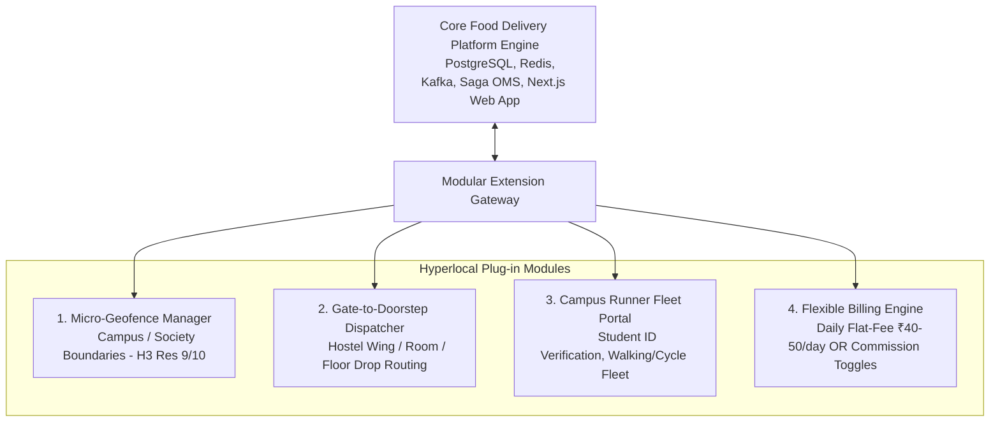

# 24 - Future Hyperlocal & Campus Plug-in Architecture

## 1. Modular Plug-in Strategy: From City-Wide to Micro-Cluster

A major strength of this architecture is its **clean modularity**. The core platform (Catalog, Cart, Saga Order State Machine, Payment Integration, and Caching) operates identically whether an order is being delivered across 5 kilometers in South Delhi or across 300 meters inside an engineering college campus.

When ready to activate **hyperlocal micro-clusters** (college campuses, hostels, hospitals, or gated townships), the system attaches a **Micro-Cluster Plug-in** without modifying the core transactional engine:



---

## 2. Database Schema Extension for Micro-Clusters

To support campus, hospital, and society delivery alongside standard city deliveries, minor non-breaking additions are made to the database schema:

```sql
-- 1. Cluster Type Definition
CREATE TYPE cluster_type AS ENUM ('OPEN_CITY', 'COLLEGE_CAMPUS', 'HOSPITAL', 'GATED_TOWNSHIP', 'TECH_PARK');
CREATE TYPE merchant_billing_model AS ENUM ('COMMISSION_PERCENTAGE', 'DAILY_FLAT_SUBSCRIPTION', 'HYBRID');

-- 2. Micro-Cluster Geofence Table
CREATE TABLE delivery_micro_clusters (
    id UUID PRIMARY KEY DEFAULT gen_random_uuid(),
    name VARCHAR(128) NOT NULL, -- e.g., 'IIT Delhi Main Campus'
    cluster_type cluster_type DEFAULT 'COLLEGE_CAMPUS',
    boundary_polygon GEOMETRY(Polygon, 4326) NOT NULL,
    h3_res9_indices TEXT[] NOT NULL,
    is_gate_restricted BOOLEAN DEFAULT TRUE,
    created_at TIMESTAMP WITH TIME ZONE DEFAULT NOW()
);

-- 3. Restaurant Billing Model Toggle
ALTER TABLE restaurants 
ADD COLUMN billing_model merchant_billing_model DEFAULT 'COMMISSION_PERCENTAGE',
ADD COLUMN commission_rate_pct NUMERIC(4, 2) DEFAULT 8.00,
ADD COLUMN daily_subscription_fee INT DEFAULT 0, -- e.g., ₹50 represented as 50
ADD COLUMN assigned_cluster_id UUID REFERENCES delivery_micro_clusters(id);

-- 4. Address Specifics for Room / Wing Delivery
ALTER TABLE addresses
ADD COLUMN cluster_id UUID REFERENCES delivery_micro_clusters(id),
ADD COLUMN hostel_or_block_name VARCHAR(64), -- e.g., 'Aravali Hostel'
ADD COLUMN room_or_floor_number VARCHAR(32); -- e.g., 'Room 304'
```

---

## 3. Dynamic Dispatcher Adaptation (Walking / Bicycle Mode)

In open-city delivery, routing assumes motorbikes moving at 25–40 km/h with traffic delays. In a campus or high-rise township, the routing engine switches dynamically:

1. **Routing Profile:** Switched from `car/motorcycle` to `foot/bicycle` in the OSRM routing engine.
2. **Elevator & Staircase Penalty:** Adds a mathematical buffer of **4 minutes per 5 floors** for high-rise buildings, or **2 minutes for walking up hostel staircases**.
3. **Restricted Access Fleets:** Only delivery partners with verified campus IDs or society entry passes are added to the candidate pool for orders originating inside that cluster's boundary polygon.

---

## 4. Supporting the Flat ₹40–50/Day Vendor Subscription

For small campus canteens or society kiosks where a flat-fee subscription is preferred over a percentage commission:

* The **Billing Engine** runs a nightly cron job:
  ```sql
  -- Nightly subscription debit from merchant wallet
  UPDATE merchant_wallets
  SET balance = balance - 50,
      updated_at = NOW()
  WHERE restaurant_id IN (
      SELECT id FROM restaurants 
      WHERE billing_model = 'DAILY_FLAT_SUBSCRIPTION' 
      AND is_active = TRUE
  );
  ```
* For orders originating from these merchants, the checkout service sets `commission_amount = 0`, while retaining standard delivery charges and platform fees from the customer.
