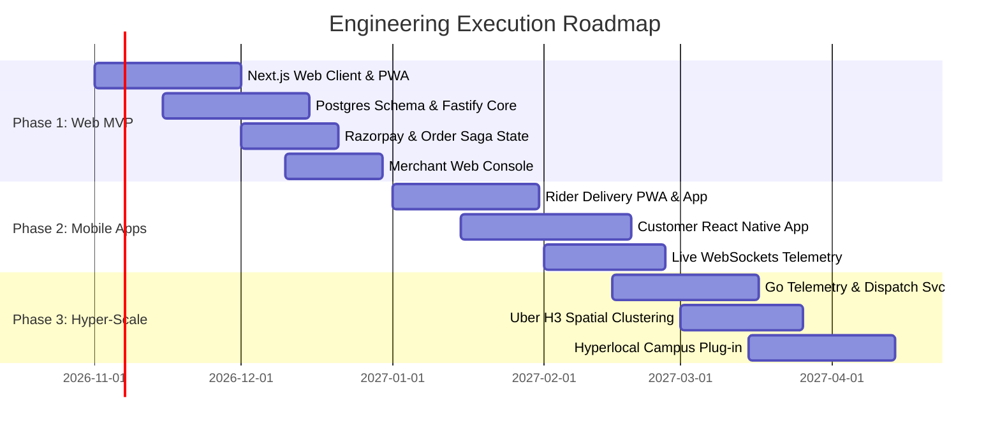

# 25 - MVP to Hyper-Scale Execution Roadmap & Cost Model

## 1. Phased Execution Timeline (24-Week Plan)

The platform follows a capital-efficient phased engineering roadmap, progressing from a lightweight, functional Web MVP to an enterprise-grade distributed system:

---

## 2. Phase-by-Phase Technical Breakdown

### Phase 1: High-Performance Web MVP (Weeks 1 – 8)
* **Objective:** Launch a functional, high-conversion web platform capable of processing 1,000 daily orders with zero capital waste.
* **Deliverables:**
  1. **Customer Web App:** Next.js 14, Tailwind CSS, Zustand cart, geolocated restaurant discovery.
  2. **Merchant Dashboard:** Web-based tablet/desktop interface with audio order notifications and 90-second accept/reject buttons.
  3. **Backend Core:** Fastify (Node.js/TypeScript) modular monolith, PostgreSQL (hosted on Supabase or AWS RDS), Redis 7.x (Upstash or AWS ElastiCache).
  4. **Payments:** Razorpay standard checkout with HMAC webhook verification.
  5. **Dispatch:** Dispatcher web dashboard allowing manual or simple nearest-rider assignment.

### Phase 2: Mobile Applications & Telemetry (Weeks 9 – 16)
* **Objective:** Expand to mobile application stores and establish live GPS rider tracking.
* **Deliverables:**
  1. **Customer Apps:** Cross-platform React Native / Expo application sharing business logic and hooks with the Next.js web client.
  2. **Delivery Partner App:** Android React Native app with background GPS tracking, battery optimization, and sound alerts for incoming deliveries.
  3. **Real-Time Gateway:** Node.js / Go WebSocket service streaming live rider coordinates directly to active web and mobile order-tracking screens.

### Phase 3: Algorithmic Scaling & Micro-Hyperlocal Plug-ins (Weeks 17 – 24)
* **Objective:** Automate fleet scheduling and activate the campus/hostel/hospital delivery modules.
* **Deliverables:**
  1. **Go Computational Engine:** Extract high-throughput dispatch and location telemetry into dedicated Go microservices.
  2. **Uber H3 Indexing:** Implement Resolution 7 (surge) and Resolution 9 (rider pooling) hexagonal grids.
  3. **Campus Plug-in:** Activate gate-to-room delivery tiers, student-runner onboarding, and daily ₹40–50 flat-fee canteen subscriptions.
  4. **Automated Batching:** Activate bipartite matching algorithm for multi-order bundles.

### Phase 4: Hyper-Scale Enterprise (Months 6+)
* **Objective:** Expand multi-city operations sustaining 50,000+ orders/day.
* **Deliverables:**
  1. Container orchestration on AWS EKS (Kubernetes) with automatic HPA scaling.
  2. Apache Kafka event backbone with Schema Registry.
  3. OpenSearch multi-node cluster with phonetic and fuzzy Indian cuisine matching.
  4. Two-Tower deep recommendation engine and Feast feature store.

---

## 3. Infrastructure Cost Estimates by Scale Tier

| Growth Tier | Daily Orders | Primary Cloud Stack | Estimated Monthly Cloud Cost |
| :--- | :---: | :--- | :---: |
| **Tier 1 (MVP)** | 100 – 1,000 | Vercel (Pro) + Supabase (Pro Postgres) + Upstash Redis + Cloudflare (Free) | **₹4,500 – ₹8,000 / month** ($55 – $100) |
| **Tier 2 (Growth)** | 5,000 – 15,000 | AWS EC2 (t4g.xlarge) + RDS Aurora Postgres + ElastiCache Redis + Cloudflare Pro | **₹35,000 – ₹60,000 / month** ($420 – $720) |
| **Tier 3 (Scale)** | 50,000 – 100,000+| Multi-AZ AWS EKS (Kubernetes) + Sharded RDS + Confluent Kafka + OpenSearch | **₹2,50,000 – ₹4,00,000 / month** ($3,000 – $4,800) |
