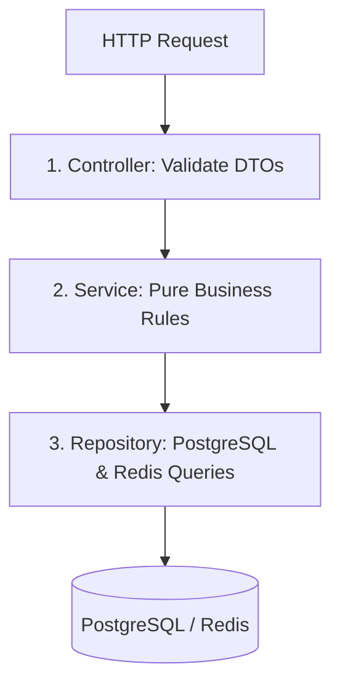

# 28 - Backend Scaffolding: Fastify & Clean Architecture

## 1. Why Fastify & Clean Architecture?

### Why Fastify Over Express?
* **4x Higher Throughput:** Express averages ~12,000 requests/second under load; Fastify averages **45,000+ requests/second** on the same Node.js runtime due to its optimized Radix-Tree router and `fast-json-stringify` schema compiler.
* **First-Class TypeScript Support:** Native type safety without hacky interface extensions.
* **Built-in Plugin Encapsulation:** Decouples modules cleanly into isolated domains.

### Why Clean Architecture?
In standard food delivery startups, developers often dump business logic inside route handlers. When the team later decides to extract the dispatch logic into Go or Java, everything breaks.

Clean Architecture enforces a strict **Three-Tier Boundary**:
1. **Controllers (HTTP/Transport Layer):** Parses HTTP headers, validates input using Zod schemas, calls the service, and serializes the HTTP response envelope.
2. **Services (Domain Logic Layer):** Pure business logic (e.g., verifying menu availability, calculating surge, triggering Saga workflows). Has zero knowledge of HTTP or Express/Fastify.
3. **Repositories (Data Access Layer):** Direct database queries (SQL / Redis). If you switch from raw PostgreSQL to Prisma or DynamoDB, only the repository layer changes.



---

## 2. Project Directory Tree

```
backend/
├── src/
│   ├── config/
│   │   └── env.ts                 # Validated environment variables (Zod)
│   ├── controllers/
│   │   ├── auth.controller.ts     # Login, OTP verification
│   │   ├── catalog.controller.ts  # Restaurant & menu feeds
│   │   └── order.controller.ts    # Checkout & order tracking
│   ├── services/
│   │   ├── catalog.service.ts     # H3 discovery math
│   │   ├── order.service.ts       # Saga state transitions
│   │   └── pricing.service.ts     # Dynamic surge & ETA
│   ├── repositories/
│   │   ├── restaurant.repo.ts     # SQL queries for restaurants
│   │   └── order.repo.ts          # SQL queries for orders & outbox
│   ├── plugins/
│   │   ├── database.plugin.ts     # PgBouncer pool lifecycle
│   │   ├── redis.plugin.ts        # Redis client & Lua scripts
│   │   └── auth.plugin.ts         # JWT verification hooks
│   ├── routes/
│   │   └── v1/
│   │       ├── catalog.routes.ts
│   │       └── order.routes.ts
│   ├── utils/
│   │   └── response.ts            # Standard envelope serializer
│   └── server.ts                  # Fastify bootstrap
├── package.json
└── tsconfig.json
```

---

## 3. Strict Environment Validation (`src/config/env.ts`)

Prevents the server from booting if critical keys or database credentials are missing:

```typescript
import { z } from "zod";
import * as dotenv from "dotenv";

dotenv.config();

const envSchema = z.object({
  PORT: z.coerce.number().default(4000),
  NODE_ENV: z.enum(["development", "production", "test"]).default("development"),
  DATABASE_URL: z.string().url("DATABASE_URL must be a valid PostgreSQL connection string"),
  REDIS_URL: z.string().url("REDIS_URL must be a valid Redis connection string"),
  JWT_ACCESS_SECRET: z.string().min(32, "JWT secret must be at least 32 characters long"),
  RAZORPAY_KEY_ID: z.string().min(1),
  RAZORPAY_KEY_SECRET: z.string().min(1),
  RAZORPAY_WEBHOOK_SECRET: z.string().min(1)
});

export const ENV = envSchema.parse(process.env);
```

---

## 4. Production Fastify Bootstrap (`src/server.ts`)

```typescript
import Fastify from "fastify";
import cors from "@fastify/cors";
import helmet from "@fastify/helmet";
import rateLimit from "@fastify/rate-limit";
import { ENV } from "./config/env";
import { catalogRoutes } from "./routes/v1/catalog.routes";
import { orderRoutes } from "./routes/v1/order.routes";

export async function buildServer() {
  const server = Fastify({
    logger: {
      level: ENV.NODE_ENV === "development" ? "info" : "warn",
      transport: ENV.NODE_ENV === "development" ? { target: "pino-pretty" } : undefined
    }
  });

  // 1. Security Headers & CORS
  await server.register(helmet);
  await server.register(cors, {
    origin: ["http://localhost:3000", "https://yourdomain.com"],
    credentials: true
  });

  // 2. Global Rate Limiting (Token Bucket)
  await server.register(rateLimit, {
    max: 100,
    timeWindow: "1 minute"
  });

  // 3. Global Error Handling Envelope
  server.setErrorHandler((error, request, reply) => {
    server.log.error(error);
    const statusCode = error.statusCode || 500;
    reply.status(statusCode).send({
      success: false,
      data: null,
      error: {
        code: error.code || "INTERNAL_ERROR",
        message: statusCode === 500 ? "Internal Server Error" : error.message
      },
      timestamp: new Date().toISOString()
    });
  });

  // 4. Register API Routes
  await server.register(catalogRoutes, { prefix: "/api/v1/restaurants" });
  await server.register(orderRoutes, { prefix: "/api/v1/orders" });

  // 5. Healthcheck Route
  server.get("/health", async () => ({ status: "HEALTHY", uptime: process.uptime() }));

  return server;
}

async function start() {
  const server = await buildServer();
  try {
    await server.listen({ port: ENV.PORT, host: "0.0.0.0" });
    console.log(`Food Delivery Core API running on http://localhost:${ENV.PORT}`);
  } catch (err) {
    server.log.error(err);
    process.exit(1);
  }
}

start();
```
