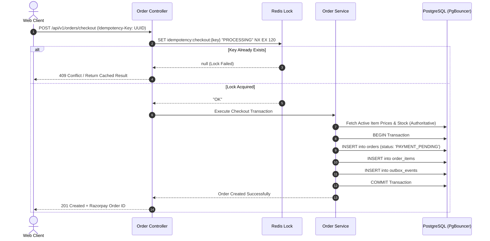

# 29 - Order Checkout & Idempotency Implementation

## 1. Why Checkout & Idempotency is the Critical Flow

In food delivery, the checkout endpoint is where financial transactions and physical inventory collide. Two major failure modes happen if checkout is naive:
1. **The Double-Click Disaster:** A customer on an unstable 4G connection clicks *"Pay Now"*, sees a 2-second spinner, and clicks it again. If your API does not enforce idempotency, two independent charges are deducted from their bank account, and the kitchen receives duplicate orders.
2. **Client-Side Price Tampering:** A malicious user modifies the client JSON payload:
   ```json
   { "menu_item_id": "biryani-uuid", "price": 10 } // Real price is ₹350!
   ```
   **Golden Security Rule:** The client payload **only specifies item IDs and quantities**. The backend recalculates item subtotal, taxes, delivery fees, and surge directly from the database and spatial models.



---

## 2. Complete Order Service Implementation (`src/services/order.service.ts`)

```typescript
import { PoolClient } from "pg";
import { Redis } from "ioredis";
import { dbPool } from "../plugins/database.plugin";
import { GeoSpatialService } from "./geospatial.service";
import { DynamicPricingEngine } from "./pricing.service";

interface CheckoutItemDTO {
  menuItemId: string;
  quantity: number;
}

interface CheckoutRequestDTO {
  userId: string;
  restaurantId: string;
  deliveryAddressId: string;
  cartItems: CheckoutItemDTO[];
  idempotencyKey: string;
}

export class OrderService {
  constructor(private redis: Redis) {}

  public async processCheckout(dto: CheckoutRequestDTO) {
    const lockKey = `idempotency:checkout:${dto.idempotencyKey}`;

    // 1. Acquire Distributed Idempotency Lock in Redis (TTL: 120 seconds)
    const acquired = await this.redis.set(lockKey, "PROCESSING", "EX", 120, "NX");
    if (!acquired) {
      throw new Error("A checkout request with this idempotency key is already in progress.");
    }

    const client: PoolClient = await dbPool.connect();

    try {
      // 2. Fetch Authoritative Menu Item Prices from PostgreSQL
      const itemIds = dto.cartItems.map((i) => i.menuItemId);
      const itemsQuery = await client.query(
        `SELECT id, name, price, is_available FROM menu_items WHERE id = ANY($1::uuid[]) AND restaurant_id = $2`,
        [itemIds, dto.restaurantId]
      );

      if (itemsQuery.rows.length !== itemIds.length) {
        throw new Error("One or more items in your basket are invalid or belong to another restaurant.");
      }

      // Check real-time dish availability
      for (const row of itemsQuery.rows) {
        if (!row.is_available) {
          throw new Error(`Item '${row.name}' is currently sold out.`);
        }
      }

      // 3. Authoritative Subtotal Calculation
      let subtotal = 0;
      const orderItemsToInsert: Array<{ id: string; name: string; price: number; quantity: number; total: number }> = [];

      for (const cartItem of dto.cartItems) {
        const dbItem = itemsQuery.rows.find((r) => r.id === cartItem.menuItemId)!;
        const itemTotal = dbItem.price * cartItem.quantity;
        subtotal += itemTotal;
        orderItemsToInsert.push({
          id: dbItem.id,
          name: dbItem.name,
          price: dbItem.price,
          quantity: cartItem.quantity,
          total: itemTotal
        });
      }

      // 4. Calculate Distance, Surge & Delivery Charge
      const addressQuery = await client.query(
        `SELECT ST_X(a.coordinates) AS user_lng, ST_Y(a.coordinates) AS user_lat,
                ST_X(r.coordinates) AS rest_lng, ST_Y(r.coordinates) AS rest_lat,
                r.h3_res8 AS rest_h3
         FROM addresses a, restaurants r
         WHERE a.id = $1 AND r.id = $2`,
        [dto.deliveryAddressId, dto.restaurantId]
      );

      if (addressQuery.rows.length === 0) {
        throw new Error("Delivery address or restaurant location not found.");
      }

      const { user_lng, user_lat, rest_lng, rest_lat, rest_h3 } = addressQuery.rows[0];
      const distanceKm = GeoSpatialService.calculateHaversineDistance(user_lat, user_lng, rest_lat, rest_lng);

      // Fetch active cell supply/demand from Redis for dynamic surge
      const activeOrders = await this.redis.scard(`orders:active:cell:${rest_h3}`);
      const availableRiders = await this.redis.scard(`h3:riders:res9:${rest_h3}`);

      const pricing = DynamicPricingEngine.calculateDeliveryCharge(distanceKm, {
        h3Index: rest_h3,
        activeOrders,
        availableRiders,
        isRaining: false,
        rainIntensityMmHr: 0
      });

      const taxAmount = Math.round(subtotal * 0.05); // 5% GST
      const totalAmount = subtotal + pricing.totalFee + taxAmount;

      // 5. Generate Secure One-Time Passwords (OTPs)
      const deliveryOtp = Math.floor(1000 + Math.random() * 9000).toString(); // 4-digit code
      const pickupOtp = Math.floor(1000 + Math.random() * 9000).toString();

      // 6. Execute Atomic PostgreSQL Transaction
      await client.query("BEGIN");

      // Insert Order
      const orderInsert = await client.query(
        `INSERT INTO orders (
          customer_user_id, restaurant_id, delivery_address_id,
          subtotal_amount, delivery_charge, surge_charge, tax_amount, total_amount,
          status, delivery_otp, pickup_otp
        ) VALUES ($1, $2, $3, $4, $5, $6, $7, $8, 'PAYMENT_PENDING', $9, $10)
        RETURNING id;`,
        [
          dto.userId,
          dto.restaurantId,
          dto.deliveryAddressId,
          subtotal,
          pricing.totalFee - pricing.surgeFee,
          pricing.surgeFee,
          taxAmount,
          totalAmount,
          deliveryOtp,
          pickupOtp
        ]
      );

      const orderId = orderInsert.rows[0].id;

      // Batch Insert Order Items
      for (const item of orderItemsToInsert) {
        await client.query(
          `INSERT INTO order_items (order_id, menu_item_id, item_name, quantity, unit_price, total_price)
           VALUES ($1, $2, $3, $4, $5, $6);`,
          [orderId, item.id, item.name, item.quantity, item.price, item.total]
        );
      }

      // Insert Transactional Outbox Event
      await client.query(
        `INSERT INTO outbox_events (aggregate_type, aggregate_id, event_type, payload)
         VALUES ('ORDER', $1, 'ORDER_CREATED', $2);`,
        [orderId, JSON.stringify({ orderId, userId: dto.userId, totalAmount, status: "PAYMENT_PENDING" })]
      );

      await client.query("COMMIT");

      // 7. Store Result in Redis for Instant Replay Protection
      const responsePayload = {
        orderId,
        status: "PAYMENT_PENDING",
        pricing: {
          subtotal,
          deliveryFee: pricing.totalFee,
          surgeFee: pricing.surgeFee,
          tax: taxAmount,
          totalAmount
        }
      };

      await this.redis.set(lockKey, JSON.stringify(responsePayload), "EX", 86400); // 24-hour persistence

      return responsePayload;
    } catch (err) {
      await client.query("ROLLBACK");
      // On failure, release lock so the user can fix the cart and retry
      await this.redis.del(lockKey);
      throw err;
    } finally {
      client.release();
    }
  }
}
```
