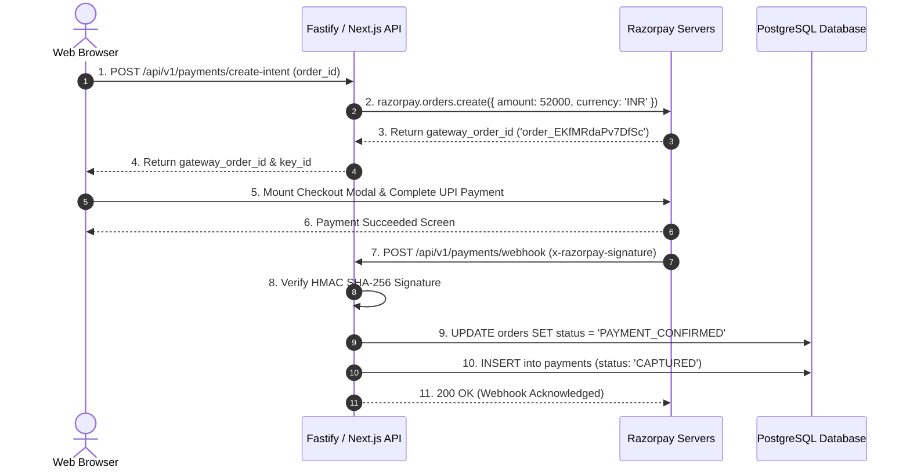

# 30 - Razorpay Payment Integration & Webhook Handler

## 1. Why Razorpay & The End-to-End Payment Flow

In India, over **80% of online food delivery orders are paid via UPI** (Google Pay, PhonePe, Paytm, CRED). Razorpay is the industry benchmark for food delivery because:
* It natively supports **UPI Intent flows** (opening Google Pay or PhonePe directly on mobile devices without typing a VPA).
* Provides sub-2-second payment authorization.
* Supports **Cryptographic Webhooks** to eliminate fraud and dropped payments.



---

## 2. Backend Payment Service (`src/services/payment.service.ts`)

Install the official SDK:
```bash
npm install razorpay
```

```typescript
import Razorpay from "razorpay";
import crypto from "crypto";
import { dbPool } from "../plugins/database.plugin";
import { ENV } from "../config/env";

const razorpay = new Razorpay({
  key_id: ENV.RAZORPAY_KEY_ID,
  key_secret: ENV.RAZORPAY_KEY_SECRET,
});

export class PaymentService {
  /**
   * Step 1: Create an authorized order inside Razorpay's system
   */
  public static async createRazorpayOrder(orderId: string, amountRupees: number) {
    // Razorpay requires amounts in Paisa (1 Rupee = 100 Paisa)
    const amountPaisa = amountRupees * 100;

    const options = {
      amount: amountPaisa,
      currency: "INR",
      receipt: `rcpt_${orderId.substring(0, 10)}`,
      notes: {
        order_id: orderId,
      },
    };

    const razorpayOrder = await razorpay.orders.create(options);
    return razorpayOrder;
  }

  /**
   * Step 2: Validate the cryptographic HMAC signature sent by Razorpay Webhooks
   */
  public static verifyWebhookSignature(rawBodyBuffer: Buffer, signature: string): boolean {
    const expectedSignature = crypto
      .createHmac("sha256", ENV.RAZORPAY_WEBHOOK_SECRET)
      .update(rawBodyBuffer)
      .digest("hex");

    return crypto.timingSafeEqual(
      Buffer.from(signature),
      Buffer.from(expectedSignature)
    );
  }

  /**
   * Step 3: Handle Payment Captured Webhook
   */
  public static async handlePaymentSuccess(paymentPayload: any) {
    const orderId = paymentPayload.notes.order_id;
    const paymentId = paymentPayload.id;
    const amountPaid = paymentPayload.amount / 100;

    const client = await dbPool.connect();

    try {
      await client.query("BEGIN");

      // 1. Update Order Status to PAYMENT_CONFIRMED
      await client.query(
        `UPDATE orders 
         SET status = 'PAYMENT_CONFIRMED', updated_at = NOW(), row_version = row_version + 1
         WHERE id = $1 AND status = 'PAYMENT_PENDING'`,
        [orderId]
      );

      // 2. Insert into Payments Ledger
      await client.query(
        `INSERT INTO payments (order_id, gateway, gateway_order_id, gateway_payment_id, amount, status, idempotency_key)
         VALUES ($1, 'RAZORPAY', $2, $3, $4, 'CAPTURED', $5)
         ON CONFLICT (order_id) DO NOTHING`,
        [orderId, paymentPayload.order_id, paymentId, amountPaid, `rzp_pay_${paymentId}`]
      );

      // 3. Emit Transactional Outbox Event to Trigger Kitchen Notification
      await client.query(
        `INSERT INTO outbox_events (aggregate_type, aggregate_id, event_type, payload)
         VALUES ('ORDER', $1, 'ORDER_PAYMENT_CONFIRMED', $2)`,
        [orderId, JSON.stringify({ orderId, paymentId, status: "PAYMENT_CONFIRMED" })]
      );

      await client.query("COMMIT");
      console.log(`Payment successfully captured for Order: ${orderId}`);
    } catch (err) {
      await client.query("ROLLBACK");
      throw err;
    } finally {
      client.release();
    }
  }
}
```

---

## 3. Webhook Route Controller (`src/controllers/payment.controller.ts`)

```typescript
import { FastifyRequest, FastifyReply } from "fastify";
import { PaymentService } from "../services/payment.service";

export async function paymentWebhookHandler(request: FastifyRequest, reply: FastifyReply) {
  const signature = request.headers["x-razorpay-signature"] as string;

  if (!signature) {
    return reply.status(400).send({ error: "Missing x-razorpay-signature header" });
  }

  // Fastify rawBody is required to prevent JSON re-serialization differences
  const rawBody = (request as any).rawBody || Buffer.from(JSON.stringify(request.body));

  const isValid = PaymentService.verifyWebhookSignature(rawBody, signature);
  if (!isValid) {
    request.log.error("Invalid Webhook Signature Detected! Potential security attack.");
    return reply.status(401).send({ error: "Unauthorized signature" });
  }

  const event = request.body as any;

  if (event.event === "payment.captured") {
    await PaymentService.handlePaymentSuccess(event.payload.payment.entity);
  }

  // Always return 200 OK to prevent Razorpay from continually retrying the webhook
  return reply.status(200).send({ received: true });
}
```

---

## 4. Client-Side Next.js Razorpay Checkout Trigger

```tsx
"use client";

export function useRazorpayCheckout() {
  const triggerPayment = async (orderId: string, amount: number, customerPhone: string) => {
    // 1. Request gateway order from backend
    const res = await fetch("/api/v1/payments/create-intent", {
      method: "POST",
      headers: { "Content-Type": "application/json" },
      body: JSON.stringify({ orderId, amount }),
    });
    const { data } = await res.json();

    // 2. Initialize Razorpay Modal
    const options = {
      key: data.keyId,
      amount: data.amount,
      currency: "INR",
      name: "Food Delivery Platform",
      description: `Order #${orderId.substring(0, 8)}`,
      order_id: data.gatewayOrderId,
      prefill: {
        contact: customerPhone,
      },
      theme: {
        color: "#FC8019", // Swiggy Orange
      },
      handler: function (response: any) {
        // Payment successful on client -> Redirect to live tracking screen
        window.location.href = `/orders/${orderId}/track`;
      },
    };

    const rzp = new (window as any).Razorpay(options);
    rzp.open();
  };

  return { triggerPayment };
}
```
