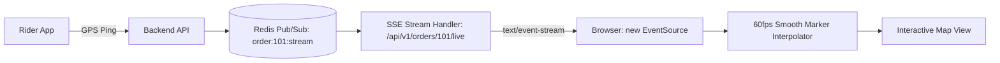

# 31 - Real-Time Tracking: SSE & WebSockets Implementation

## 1. Why Server-Sent Events (SSE) for Web Order Tracking?

Many developers assume they must use full bi-directional WebSockets for live maps. In reality, **Server-Sent Events (SSE)** is the superior choice for customer web tracking:
1. **Unidirectional Simplicity:** The customer browser only needs to *receive* rider GPS updates and status milestones. They never stream continuous telemetry back to the server.
2. **Native Auto-Reconnection:** If a user drives into a tunnel or switches Wi-Fi networks, the browser’s native `EventSource` automatically reconnects and replays from the last event ID without writing complex heartbeat code.
3. **HTTP/2 Multiplexing:** SSE runs over standard HTTPS. It passes effortlessly through corporate firewalls, cellular proxies, and Cloudflare CDNs that frequently block or drop raw WebSocket TCP upgrades.



---

## 2. Fastify SSE Server Endpoint (`src/routes/tracking.routes.ts`)

```typescript
import { FastifyInstance, FastifyRequest, FastifyReply } from "fastify";
import Redis from "ioredis";
import { ENV } from "../config/env";

export async function trackingRoutes(server: FastifyInstance) {
  server.get("/:orderId/live", async (request: FastifyRequest, reply: FastifyReply) => {
    const { orderId } = request.params as { orderId: string };

    // 1. Set required SSE HTTP headers
    reply.raw.writeHead(200, {
      "Content-Type": "text/event-stream",
      "Cache-Control": "no-cache, no-transform",
      "Connection": "keep-alive",
      "Access-Control-Allow-Origin": "*",
    });

    const subRedis = new Redis(ENV.REDIS_URL);
    const channel = `order:${orderId}:stream`;

    // 2. Push initial status snapshot
    reply.raw.write(`event: connected\ndata: ${JSON.stringify({ status: "STREAM_ESTABLISHED" })}\n\n`);

    // 3. Subscribe to Redis channel for this order
    await subRedis.subscribe(channel);

    subRedis.on("message", (_chan, message) => {
      // Forward Redis event directly down the HTTP/2 stream
      reply.raw.write(`event: location_update\ndata: ${message}\n\n`);
    });

    // 4. Memory Leak Prevention: Clean up Redis client on disconnect
    request.raw.on("close", () => {
      subRedis.unsubscribe(channel);
      subRedis.quit();
      reply.raw.end();
    });
  });
}
```

---

## 3. Client React Hook: Smooth Map LERP Interpolation (`useOrderTracking.ts`)

```typescript
"use client";

import { useEffect, useState, useRef } from "react";

export interface RiderCoordinates {
  lat: number;
  lng: number;
  heading: number;
  speed: number;
}

export function useOrderTracking(orderId: string) {
  const [currentCoord, setCurrentCoord] = useState<[number, number] | null>(null);
  const [orderStatus, setOrderStatus] = useState<string>("PREPARING");
  const animationRef = useRef<number | null>(null);

  useEffect(() => {
    const eventSource = new EventSource(`/api/v1/orders/${orderId}/live`);

    eventSource.addEventListener("location_update", (e) => {
      const payload = JSON.parse(e.data);
      const newCoord: [number, number] = [payload.lng, payload.lat];

      if (!currentCoord) {
        setCurrentCoord(newCoord);
        return;
      }

      // Smoothly interpolate between current and new coordinate over 4 seconds
      const startCoord = currentCoord;
      const startTime = performance.now();
      const DURATION_MS = 4000;

      function animate(time: number) {
        const elapsed = time - startTime;
        const progress = Math.min(elapsed / DURATION_MS, 1);

        // Linear interpolation formula (LERP)
        const interpolatedLng = startCoord[0] + (newCoord[0] - startCoord[0]) * progress;
        const interpolatedLat = startCoord[1] + (newCoord[1] - startCoord[1]) * progress;

        setCurrentCoord([interpolatedLng, interpolatedLat]);

        if (progress < 1) {
          animationRef.current = requestAnimationFrame(animate);
        }
      }

      if (animationRef.current) cancelAnimationFrame(animationRef.current);
      animationRef.current = requestAnimationFrame(animate);
    });

    eventSource.onerror = () => {
      console.warn("SSE connection lost. Browser will auto-reconnect...");
    };

    return () => {
      eventSource.close();
      if (animationRef.current) cancelAnimationFrame(animationRef.current);
    };
  }, [orderId]);

  return { currentCoord, orderStatus };
}
```
