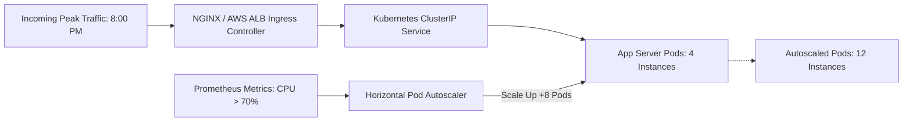

# 34 - Production Deployment: Kubernetes & Terraform Blueprint

## 1. Why Kubernetes & Terraform for Food Delivery Scale?

Food delivery traffic is notoriously spiky:
* **Off-Peak (3:00 AM – 7:00 AM):** 100 requests/minute.
* **Lunch Peak (1:00 PM – 2:30 PM):** 15,000 requests/minute.
* **Dinner Peak (8:00 PM – 10:00 PM):** 45,000 requests/minute.

Running static virtual machines results in either **wasting ₹2,00,000/month on idle capacity at night** or **crashing under sudden dinner peaks**.

**Kubernetes Horizontal Pod Autoscaler (HPA)** automatically scales application pods up from 4 to 40 within 45 seconds when CPU utilization crosses 70%, and scales back down when the peak subsides.



---

## 2. Production Kubernetes Manifests

### 1. Application Deployment (`k8s/deployment.yaml`)
```yaml
apiVersion: apps/v1
kind: Deployment
metadata:
  name: food-delivery-api
  namespace: production
  labels:
    app: food-delivery-api
spec:
  replicas: 4
  revisionHistoryLimit: 5
  strategy:
    type: RollingUpdate
    rollingUpdate:
      maxSurge: 25%
      maxUnavailable: 0 # Zero-downtime rolling deploys
  selector:
    matchLabels:
      app: food-delivery-api
  template:
    metadata:
      labels:
        app: food-delivery-api
    spec:
      containers:
        - name: api
          image: 123456789012.dkr.ecr.ap-south-1.amazonaws.com/food-delivery-api:v1.0.4
          imagePullPolicy: IfNotPresent
          ports:
            - containerPort: 4000
          envFrom:
            - configMapRef:
                name: api-config
            - secretRef:
                name: api-secrets
          resources:
            requests:
              cpu: "250m"
              memory: "256Mi"
            limits:
              cpu: "1000m"
              memory: "768Mi"
          livenessProbe:
            httpGet:
              path: /health
              port: 4000
            initialDelaySeconds: 15
            periodSeconds: 10
            timeoutSeconds: 3
            failureThreshold: 3
          readinessProbe:
            httpGet:
              path: /health
              port: 4000
            initialDelaySeconds: 5
            periodSeconds: 5
            timeoutSeconds: 2
            successThreshold: 1
```

### 2. Horizontal Pod Autoscaler (`k8s/hpa.yaml`)
```yaml
apiVersion: autoscaling/v2
kind: HorizontalPodAutoscaler
metadata:
  name: food-delivery-api-hpa
  namespace: production
spec:
  scaleTargetRef:
    apiVersion: apps/v1
    kind: Deployment
    name: food-delivery-api
  minReplicas: 4
  maxReplicas: 35
  metrics:
    - type: Resource
      resource:
        name: cpu
        target:
          type: Utilization
          averageUtilization: 70
    - type: Resource
      resource:
        name: memory
        target:
          type: Utilization
          averageUtilization: 80
```

---

## 3. Terraform Cloud Infrastructure Blueprint (`terraform/main.tf`)

Provisions a multi-availability zone AWS EKS cluster with managed Node Groups in the Mumbai region (`ap-south-1`):

```hcl
terraform {
  required_version = ">= 1.5.0"
  required_providers {
    aws = {
      source  = "hashicorp/aws"
      version = "~> 5.0"
    }
  }
}

provider "aws" {
  region = "ap-south-1" # AWS Mumbai (Lowest latency for India)
}

# 1. Dedicated Multi-AZ VPC
module "vpc" {
  source  = "terraform-aws-modules/vpc/aws"
  version = "5.1.0"

  name = "food-delivery-production-vpc"
  cidr = "10.0.0.0/16"

  azs             = ["ap-south-1a", "ap-south-1b", "ap-south-1c"]
  private_subnets = ["10.0.1.0/24", "10.0.2.0/24", "10.0.3.0/24"]
  public_subnets  = ["10.0.101.0/24", "10.0.102.0/24", "10.0.103.0/24"]

  enable_nat_gateway   = true
  single_nat_gateway   = false # High availability across AZs
  enable_dns_hostnames = true
}

# 2. Managed AWS EKS Cluster
module "eks" {
  source  = "terraform-aws-modules/eks/aws"
  version = "19.15.0"

  cluster_name    = "food-delivery-production-eks"
  cluster_version = "1.28"

  vpc_id     = module.vpc.vpc_id
  subnet_ids = module.vpc.private_subnets

  eks_managed_node_groups = {
    core_workers = {
      min_size     = 3
      max_size     = 15
      desired_size = 4

      instance_types = ["t4g.xlarge"] # Graviton 3 (ARM64) for 40% cost savings
      capacity_type  = "ON_DEMAND"
    }
  }
}

# 3. AWS RDS Aurora PostgreSQL Cluster (Multi-AZ with Read Replica)
module "aurora_postgres" {
  source  = "terraform-aws-modules/rds-aurora/aws"
  version = "8.3.0"

  name           = "food-delivery-production-db"
  engine         = "aurora-postgresql"
  engine_version = "15.4"
  instance_class = "db.r6g.large"

  instances = {
    primary = {}
    replica = {} # Read replica for search & analytics
  }

  vpc_id  = module.vpc.vpc_id
  subnets = module.vpc.private_subnets

  storage_encrypted   = true
  apply_immediately   = false
  monitoring_interval = 10
}
```

---

## 4. GitHub Actions CI/CD Pipeline (`.github/workflows/deploy.yml`)

Automates testing, Docker container packaging, and zero-downtime rolling deployment on every push to the `main` branch:

```yaml
name: Deploy Production API

on:
  push:
    branches: [main]

jobs:
  build-and-deploy:
    runs-on: ubuntu-latest
    steps:
      - name: Checkout Code
        uses: actions/checkout@v4

      - name: Setup Node.js
        uses: actions/setup-node@v4
        with:
          node-version: 20
          cache: "npm"

      - name: Install & Run Unit Tests
        run: |
          npm ci
          npm run test

      - name: Configure AWS Credentials
        uses: aws-actions/configure-aws-credentials@v4
        with:
          aws-access-key-id: ${{ secrets.AWS_ACCESS_KEY_ID }}
          aws-secret-access-key: ${{ secrets.AWS_SECRET_ACCESS_KEY }}
          aws-region: ap-south-1

      - name: Login to Amazon ECR
        id: login-ecr
        uses: aws-actions/amazon-ecr-login@v2

      - name: Build and Push Docker Image
        env:
          ECR_REGISTRY: ${{ steps.login-ecr.outputs.registry }}
          IMAGE_TAG: ${{ github.sha }}
        run: |
          docker build -t $ECR_REGISTRY/food-delivery-api:$IMAGE_TAG .
          docker push $ECR_REGISTRY/food-delivery-api:$IMAGE_TAG

      - name: Deploy to Kubernetes Cluster (Rolling Update)
        run: |
          aws eks update-kubeconfig --name food-delivery-production-eks --region ap-south-1
          kubectl set image deployment/food-delivery-api api=${{ steps.login-ecr.outputs.registry }}/food-delivery-api:${{ github.sha }} -n production
          kubectl rollout status deployment/food-delivery-api -n production --timeout=180s
```
