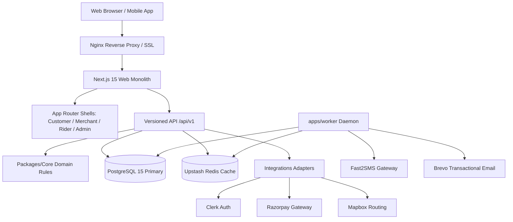

# System Architecture Specification

## 1. Architectural Philosophy & Overview

The ZomatoFresh platform is structured as a **clean modular monolith with an independent durable background worker**, prioritizing:
1. **Financial and State Correctness**: Money calculations are strictly executed in integer paise using value objects. State transitions are strictly governed by formal state machine transition tables.
2. **PostgreSQL as the Single Durable Truth**: PostgreSQL 15+ holds all transactional entities, state transitions, idempotency records, ledger entries, and durable job queues (`SKIP LOCKED`). Redis serves exclusively as an ephemeral cache and hot rider telemetry buffer—never financial truth.
3. **Decoupled Architecture with Clean Boundaries**:
   - `packages/contracts`: Portable Zod schemas, state enums, standard error envelopes, and public DTOs.
   - `packages/core`: Pure domain logic, pricing calculator, order/payment state machines, dispatch algorithms, and double-entry ledger models. Zero HTTP or database dependencies.
   - `packages/database`: Drizzle ORM schemas, migration streams, deterministic seed data, and transactional repositories.
   - `packages/integrations`: Production adapters for Clerk, Razorpay, Upstash Redis, Mapbox, Fast2SMS, and Brevo transactional emails.
   - `packages/api-client`: Universal HTTP client consuming contracts for browser and mobile clients.
   - `apps/web`: Next.js 15 App Router application hosting customer, merchant, rider, and admin experiences alongside `/api/v1` routes.
   - `apps/worker`: Node.js daemon consuming background tasks (e.g. merchant timeout enforcement, auto-refund triggers, dispatch offers).



---

## 2. Component Directory Architecture

```text
startup/
├── apps/
│   ├── web/                     # Next.js 15 App Router web monolith
│   │   ├── src/app/
│   │   │   ├── (customer)/      # Zomato-familiar customer UI
│   │   │   ├── (merchant)/      # 90s SLA merchant kitchen console
│   │   │   ├── (rider)/         # Delivery trip milestones & OTP entry
│   │   │   ├── (admin)/         # Live orders board & financial refunds
│   │   │   └── api/v1/          # High-performance versioned REST API
│   │   └── src/components/      # Reusable UI component library (Tailwind CSS)
│   └── worker/                  # Durable background jobs runner
├── packages/
│   ├── contracts/               # Enums, DTOs, schemas, and event contracts
│   ├── core/                    # Domain logic, money math, state machines
│   ├── database/                # Drizzle schema, migrations, repositories
│   ├── integrations/            # Razorpay, Clerk, Upstash, Mapbox, Fast2SMS, Brevo
│   ├── api-client/              # Universal client library
│   └── config/                  # Environment schemas and validation
├── infra/                       # Docker, Compose, Nginx, deployment scripts
└── docs/implementation/         # Architecture, ADRs, runbooks, OpenAPI spec
```

---

## 3. Invariants & Rules

1. **Integer Money**: All monetary amounts (`price_paise`, `subtotal_paise`, `tax_paise`, `delivery_fee_paise`, `discount_paise`) are non-negative integer paise. Floating-point rupees are prohibited in domain and database layers.
2. **Durable Client Idempotency**: All mutating operations (checkout, payment verification, refunds) require an `Idempotency-Key` or derive an atomic transaction key. Replaying the identical request returns the cached result without duplicate execution.
3. **Guarded State Transitions**: Orders only progress along valid state vectors. Invalid transitions throw typed domain exceptions.
4. **Single Active Order per Rider**: Dispatch assignments adhere strictly to a 1:1 active delivery model to ensure quality of service and prevent order starvation.
5. **Double-Entry Balanced Ledger**: Every monetary movement generates balanced debit and credit entries (`sum(debit) == sum(credit)`).
